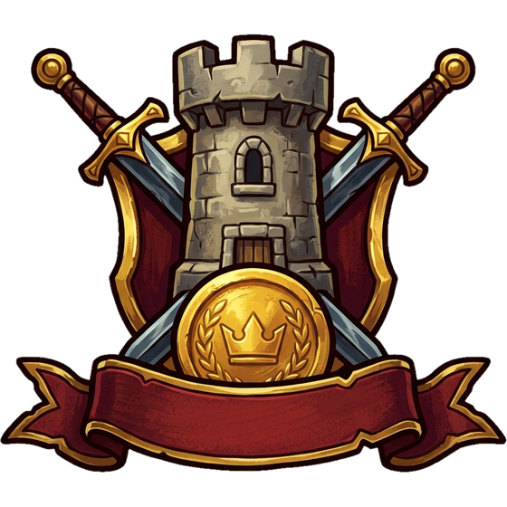

<h1 align="center">Warriors &amp; Wealth</h1>

<a href="Wiki/IT/README.md">🇮🇹 <b>Italiano</b></a> &nbsp;·&nbsp; <a href="Wiki/EN/README.md">🇬🇧 <b>English</b></a> &nbsp;·&nbsp; <a href="https://milos.warriorsandwealth.com:8448/index.html">▶️ <b>Gioca ora / Play now</b></a>

---

## 🇮🇹 Italiano

Benvenuto, futuro sovrano.

Un villaggio ti attende: poche capanne, campi non ancora coltivati e mura che devono ancora essere alzate. Sta a te trasformarlo in un impero capace di resistere agli assalti barbari e alle ambizioni degli altri giocatori.

**Warriors & Wealth** è un gioco strategico multiplayer ambientato in un'epoca medievale, dove ogni giocatore costruisce, amministra e difende il proprio villaggio in una competizione costante per risorse, territorio e prestigio. Tra un ordine di costruzione e l'altro dovrai bilanciare economia e forza militare: potenzia gli edifici civili per sostenere la crescita, addestra il tuo esercito nelle caserme, e scegli quando colpire, che sia una spedizione contro un Villaggio Barbaro o un attacco diretto contro le mura di un altro giocatore.

📖 **La wiki ufficiale** spiega ogni parte del gioco con gli stessi nomi di schede e pulsanti che vedi nel client, ed è disponibile anche dentro il gioco, dal menu del giocatore.

**Da dove cominciare:** [Benvenuto in Warriors & Wealth](Wiki/IT/Introduzione.md) · [Guida rapida](Wiki/IT/Guida-rapida.md) · [Risorse](Wiki/IT/Risorse.md) · [Esercito](Wiki/IT/Esercito.md) · [La Città e la difesa](Wiki/IT/La-Citta-e-la-difesa.md) · [PVP: sfidare i giocatori](Wiki/IT/PVP-sfidare-i-giocatori.md) · [Quest Mensili](Wiki/IT/Quest-Mensili.md) · [Domande frequenti](Wiki/IT/Domande-frequenti.md)

➡️ [Apri l'indice completo della wiki](Wiki/IT/README.md)

---

## 🇬🇧 English

Welcome, future sovereign.

A village awaits you: a few huts, fields not yet sown and walls yet to be raised. It is up to you to turn it into an empire able to withstand barbarian raids and the ambitions of other players.

**Warriors & Wealth** is a multiplayer strategy game set in the Middle Ages, where every player builds, manages and defends their own village in a constant contest for resources, land and prestige. Between one construction order and the next you will have to balance economy and military strength: upgrade civil buildings to sustain growth, train your army in the barracks, and choose when to strike, whether on an expedition against a Barbarian Village or a direct attack on another player's walls.

📖 **The official wiki** explains every part of the game using the same tab and button names you see in the client, and it is also available inside the game, from the player menu.

**Where to start:** [Welcome to Warriors & Wealth](Wiki/EN/Introduction.md) · [Quick start](Wiki/EN/Quick-start.md) · [Resources](Wiki/EN/Resources.md) · [Army](Wiki/EN/Army.md) · [The City and defense](Wiki/EN/The-City-and-defense.md) · [PVP: challenging players](Wiki/EN/PVP-challenging-players.md) · [Monthly Quests](Wiki/EN/Monthly-Quests.md) · [Frequently asked questions](Wiki/EN/FAQ.md)

➡️ [Open the full wiki index](Wiki/EN/README.md)

---

<a href="#">Torna in alto ↑ / Back to top ↑</a>

