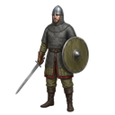
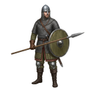

[📖 Wiki index](README.md) › 🏘️ The village &nbsp;·&nbsp; [🇮🇹 Italiano](../IT/Esercito.md)

# Army

*The four troop classes, how they are trained, how much they cost to maintain and how traps work.*

---

## Four classes, one army

Your troops are the liveliest part of the village: they defend when you're away, attack when you decide to move out and, in the meantime, they make you pay for them. The game has four classes, each with its own character.

- <b> Warriors</b> — The basic infantry: balanced in everything, with no obvious weak points. A safe choice in every phase of the game.
- <b> Spearmen</b> — A little sturdier and able to carry more. They are the backbone of those who want troops that can take a hit.
- <b> Archers</b> — They hit hard and from afar, but are fragile in defense. They consume  **Arrows** during battles.
- <b> Catapults</b> — The most powerful units and the ones that carry the most loot. They cost a lot in resources and Population, and they also live on Arrows.

Each class exists in **five levels** (I–V): as the level goes up, Health, Attack, Defense and Carrying capacity (that is, how much loot they can carry) go up. The exact values are in the **Training** screen and may be adjusted over time: what you see there is the truth.

## Levels are unlocked with Technology

At the beginning you only have **level I** units available. For the others you don't need to raise your player level: you need [Technology](Research-and-Technology.md), where each research branch contains an *unlock* that opens the next level, for all four classes. In Training the **I – II – III – IV – V** buttons show which levels you have already opened (with a ✓) and which are still closed (with a 🔒).

## Training troops

1. Open **Construction → Training**.
2. Choose the level with the **I – V** buttons: the rows show the four classes of that level.
3. With **+** and **−** you decide how many units to train for each class. The **i** button shows cost, time and statistics, already multiplied by the chosen quantity.
4. Press **Recruit**: the order starts all together.

For the training to succeed, **all** of these conditions must be true:

| You need | Why |
| --- | --- |
| A **Barracks** of the right class | Without a Warrior Barracks you can't train Warriors, and so on for the others. |
| An **unlocked** level | Levels II–V are opened with Technology. |
| **Free space** in the Barracks | Each class has a maximum limit, decided by the number of Barracks. |
| **Resources** and  **Population** | You pay for all of them immediately, even for the units waiting in the queue. |
| The required **equipment** | Swords, Spears, Bows, Shields or Armor, depending on the unit: the **i** button tells you what is needed. |

The game checks everything before starting: if something is missing, that class doesn't start and you pay nothing. The Log tells you if you've run out of Barracks space, if the level isn't unlocked yet or if the resources aren't enough. If you train several classes together, each one is evaluated on its own: the ones that have everything start.

## The Barracks limit

Each class has a **maximum limit** of troops, and that limit depends on how many Barracks of that type you own. Barracks aren't upgraded: if you want more places, you build another one (remember that they have an upkeep).

The count includes **all** the units of that class: the ones in the village, the ones queued or in training and also the ones **deployed in the City defenses**. A troop moved to a garrison still takes up its place in the Barracks. In the Overview, **Army** tab, each bar shows it with two colors: the **green** part is the units present in the village (the written number is that one), the **orange** part is the units of the same level deployed in the defenses.

## The queues: Recruiters

How many units are trained *at the same time* is decided by your **Recruiters**, which you see in the Overview, **Army** tab. You have one by default; more come with the Shop packs and with certain items. Units beyond the Recruiters wait their turn and start on their own.

- **Speed up.** With  **Blue Diamonds** you reduce the training time: the game shows you in advance how much.
- **Cancel queued training.** It cancels the units *not yet started* and refunds only a part of the cost (the confirmation tells you how much).
- **Dismiss.** The trash can at the bottom of a unit's card in the Overview removes a certain number of them. **It refunds nothing**, and it works only on free units in the village: the ones deployed in the defenses must first be recalled. It's the only way to make room when you need to demolish a Barracks.

Training times are also shortened by [Research](Research-and-Technology.md) (*Training*), by Technology and by the VIP bonus.

## The cost of maintaining an army

Troops cost  **Food** and  **Gold** every second, all of them, including the ones standing guard in the City. That is why the Food and Gold card has an *Army* line. The larger and more advanced your army, the more it weighs. Before enlisting, check the **net** production: we talk about it in [Resources](Resources.md).

> [!WARNING]
> **The classic mistake**
>
> An army trained in a moment of enthusiasm and then left to consume. If the net production of Food or Gold goes below zero, the stocks empty out and you can't even build the Farm that would fix things. Better a smaller, sustainable force.

## Traps

They are defenses that aren't trained: they are **built**, and they work silently until someone attacks your village. There are five types, from the simplest to the deadliest: **Caltrops, Hedgehogs, Pavises, Greek Fire and Ballistae**.

- **To build them** you need at least one **Trap Workshop** (Construction → Buildings → Military Structures). After that, you order them from **Construction → Training**, in the *Traps* section, with the **Build traps** button.
- **How many types** you can use is decided by [Technology](Research-and-Technology.md): every type beyond the first has its own unlock.
- **How many** you can have depends on the number of Trap Workshops: the total includes the ready ones, the ones under construction and the ones already deployed.
- **Trap makers.** They are your trap construction queue: one by default, one more with the dedicated Shop pack.
- **Where they stand.** Once ready they must be deployed in the City defenses (*Entrance* and *Walls*) from the **City** screen. How much space they have is increased by the [Research](Research-and-Technology.md) *Traps*.
- **In the Overview**, in the Army tab, the **Army / Traps** selector lets you see your traps, with progress bars, *Speed up*, *Cancel queued traps* and the trash can to remove them (here too, with no refund).

How they behave during a siege is explained in the City defense guide.

## Frequently asked questions

<b>I can't train a class: why?</b>

Check the conditions in the table above. The two most frequent reasons are a missing Barracks (or one already at its limit) and a level still locked by Technology.

<b>Does a troop deployed in defense take up space in the Barracks?</b>

Yes: it always counts, even if it's no longer in the village. That is why the Overview bar has an orange part.

<b>Which class is best to train first?</b>

It depends on how you want to play. Warriors are the easiest choice to start with; those who focus on defense love Spearmen; those who want to hit hard invest in Archers and Catapults, remembering however to have an Arrow Workshop.

<b>Can I get the resources back if I dismiss a unit?</b>

No. Dismissing refunds nothing. It's used to make room or to lighten the upkeep.

<b>Where do I see my troops' statistics?</b>

In the Training screen (the unit's **i** button) and in the **Statistics** tab, where you also find the bonuses you are accumulating with Research and Technology.

---

⬅️ [Previous: Construction and buildings](Construction-and-buildings.md) &nbsp;·&nbsp; [📖 Wiki index](README.md) &nbsp;·&nbsp; [Next: Research and Technology](Research-and-Technology.md) ➡️
