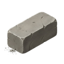
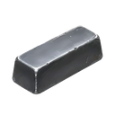

[📖 Wiki index](README.md) › 🗺️ The world &nbsp;·&nbsp; [🇮🇹 Italiano](../IT/Citta-e-Villaggi-Barbari.md)

# Barbarian Cities and Villages

*How the Barbarians are built: personal Villages and Kingdom Cities, the twenty-level ladder, the loot and the monthly renewal.*

---

## The always-available enemy

The **Barbarians** are not players. Nobody governs them, nobody helps them and they answer to no one: they are the fixed enemy of the world, always there when you have troops to test and resources to earn. This page tells you *how they are built*; how to attack them, step by step, is explained in [PVE: Barbarians](PVE-Barbarians.md).

## Two families, two ways to play

| Village | City |
| --- | --- |
| A **personal** camp: each player has one, and nobody else can touch yours. It adapts to *you*: its defenders and its stocks are measured on your level at the moment of renewal. It is the everyday training ground, low risk. | A fortress **shared** by the whole Kingdom. The garrisons are larger, the stocks much richer and, only here, there is the chance to earn  **Purple Diamonds**. It adapts to the *Kingdom*: the stronger its players, the harder and more generous its Cities. |

## The twenty-level ladder

Both Villages and Cities are a **ladder of twenty levels**, from the easiest to the hardest. You climb one step at a time: the next level only appears after defeating the previous one. The level decides two distinct things:

- **How strong the individual soldiers are.** Each level fields the four classes (**Warriors, Spearmen, Archers, Catapults**) all at the same training level, and the higher you go on the ladder, the higher that level: the Barbarians of the upper steps are better equipped than the early ones. You read their precise statistics in the Report, in the *Barbarian Troop Stats* section (see [Battle reports](Battle-reports.md)).
- **How many there are.** The garrison grows step after step, and even more for Cities than for Villages.

The loot also follows the ladder: the higher the level, the richer the stocks, and so is the  **Experience** you earn by defeating them. So there is no rush: climbing the ladder is exactly how your army grows together with the challenges.

## What they keep

|  | Village | City |
| --- | --- | --- |
| Civilian resources |  **Food**,  **Wood**,  **Stone**,  **Iron**,  **Gold** | The same five, in much larger amounts |
|  **Blue Diamonds** | Yes | Yes, in much larger amounts |
|  **Purple Diamonds** | No | Yes, with weekly limits per player |
| Who the loot belongs to | Only you | The whole Kingdom: whoever takes it removes it from the others |

Stocks are not infinite: what you carry away leaves the target's storage and is no longer there, not even for your Kingdom mates in the case of Cities. The [Kingdoms](Kingdoms.md) page talks about it too, with everything worth knowing about Purple Diamonds.

## Wounds that remain

The Barbarians are not rebuilt after every clash. If you don't eliminate them all, the survivors stay as they were and you find them so at the next attack, yours or anyone else's in the case of a City. Only the Health and Defense bars of the structure go back up, slowly, as time passes. That is why Cities lend themselves to teamwork: one player wears them down, another finishes them, and [Rallies](Rallies.md) exist exactly for this.

## The monthly renewal

Once a month, on the first day, the barbarian world renews itself. The Cities become new again, with defenses and stocks at the maximum and calibrated on the current strength of the Kingdom. Your Villages restart from the lowest step, recalculated on your level at that time. Whoever had completed the ladder starts it again, but with opponents tuned to their current strength: it's how the game prevents the Barbarians from becoming too easy or too hard as months go by.

> [!TIP]
> **The right moment**
>
> If you still have loot to take on an already defeated level, don't put it off past the renewal: then it starts over. On the other hand, right after the renewal the Cities are intact and at maximum stocks, the best moment to organize a [Rally](Rallies.md).

## Frequently asked questions

<b>Why do my Villages start over every month?</b>

Because the ladder renews together with the world. Starting from the bottom doesn't erase anything you've earned: everything stays in your village, and the new steps are tuned to your current level.

<b>Can I skip a level?</b>

No. The next one opens only after defeating the previous one, both in Villages and in Cities.

<b>If I change Kingdom what happens to my Villages?</b>

They stay yours, identical. The Cities change instead, since they are those of the new Kingdom.

<b>Which is better: Village or City?</b>

Villages are the safe choice when you want to test your army or recover resources calmly. Cities are richer, but harder and shared: it's best to attack them with a well-prepared army or in a group.

---

⬅️ [Previous: Kingdoms](Kingdoms.md) &nbsp;·&nbsp; [📖 Wiki index](README.md) &nbsp;·&nbsp; [Next: Rallies](Rallies.md) ➡️
