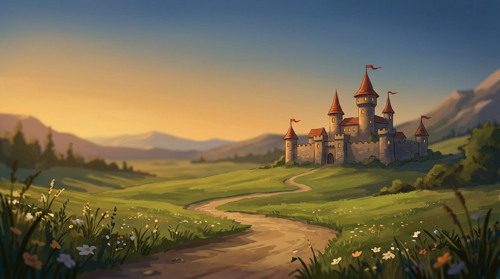

[📖 Wiki index](README.md) › 🧭 First steps &nbsp;·&nbsp; [🇮🇹 Italiano](../IT/Introduzione.md)

# Welcome to Warriors & Wealth

*What kind of game it is, how a session works, and where to find everything.*

---

## The game in brief

**Warriors & Wealth** is an online medieval strategy game. You start from a small village and make it grow: you build, research, train an army, and use it to take on the Barbarian Cities and the other players in your Kingdom. You don't need lightning-fast reflexes: what counts is planning, patience, and the ability to coordinate with others.

Your village doesn't stop when you log out: resources keep being produced even while you're away. This also means it can be attacked while you're offline, which is why defense and the *Peace Shield* matter as much as attack.

## How a session works

There isn't a single way to play, but almost everything revolves around this cycle.

1. **Produce.** Farms, sawmills, quarries and mines supply the resources; houses hold the population you need to build and to train.
2. **Build.** Every upgraded building makes the village stronger, but it takes resources and time. The more queues you have, the more you can do at once.
3. **Research.** Technologies improve production, troops and defenses, and many require a minimum level.
4. **Train.** Warriors, Spearmen, Archers and Catapults are trained in the Barracks and cost resources and population, as well as upkeep.
5. **Defend.** Deploy your troops in the structures of your City: they are the ones who stop whoever comes to plunder you.
6. **Fight.** Attack Barbarian Villages and Cities, challenge other players in PVP, or join a Rally. Winning earns you loot and experience.
7. **Grow.** Experience raises your level, and your level opens new research, defenses and battles. Then you start over, stronger.

## Resources

The game runs on **five civilian resources** (food, wood, stone, iron and gold) plus the  **population**. To equip the army you also need the **military resources**, such as Swords, Spears, Bows, Shields, Armor and Arrows. On top of these come the **Diamonds**: Blue ones are mostly used to speed things up, Purple ones are the rarest and most precious. Every resource has a dedicated guide in this wiki.

## Where to find what

At the bottom you'll find the main tabs of the game. Your name, at the top, opens the **player menu** instead.

| Tab | What it is for |
| --- | --- |
| Overview | The big picture of your village, with the news of the latest events. |
| Construction | The buildings to build and upgrade, the training of troops and the traps. |
| City | The fortified part of the village: here you deploy troops in the defensive structures and repair them after a siege. |
| Shop | Purchases with Diamonds, including the items you then find in the Inventory. |
| Research | The technologies that improve structures, armies and strategies. |
| Technology | The tree of permanent bonuses, which unlocks as you level up. |
| Statistics | Power, bonuses and active boosts, with the time left on the temporary ones. |
| Inventory | The items you own and the active timed bonuses. |
| PVP/PVE | Exploring enemies, attacking them, organizing Rallies and rereading Reports. |
| GamePass | The daily rewards. |
| Monthly Quests | The missions of the month, with points and rewards. |

The player menu gathers the things that concern *you* more than the village: switching village, the profile picture, the [Kingdoms](Kingdoms.md), this Wiki, the security options and the privacy policy.

## First of all: stay calm

> [!TIP]
> **Tip**
>
> At the beginning the best way to grow is not to rush into fighting. Strengthen your production, always keep something in construction and in research, and only then think about the army. When you attack, *explore before you strike*: knowing what awaits you is worth more than a thousand extra soldiers.

## How to read this wiki

> [!NOTE]
> **A note on numbers**
>
> The wiki explains the rules of the game as they are, using the exact names of the tabs and buttons you see on screen. The precise values (costs, times, limits) may be adjusted over time: that is why, when a number matters, we tell you where to look at it in the game. What you see in the client is always the truth.

If you don't know where to start, browse the index: every page is meant to be read on its own, and when another one is needed there's a link. You can also use the search at the top.

---

[📖 Wiki index](README.md) &nbsp;·&nbsp; [Next: Quick start](Quick-start.md) ➡️
