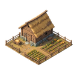
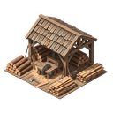
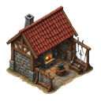
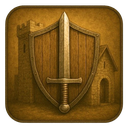
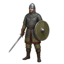
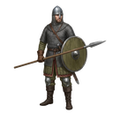

[📖 Wiki index](README.md) › 📈 Growth &nbsp;·&nbsp; [🇮🇹 Italiano](../IT/Quest-Mensili.md)

# Monthly Quests

*The goals of the month, the points bar and the rewards to claim.*

---

## A to-do list, and a prize every time

**Monthly Quests** are goals the game offers you while you play: building, training, spending resources, taking on the Barbarians and more. Every time you complete one, you earn *points* that fill a bar; when the bar reaches certain milestones, rewards in **Diamonds** unlock. There is nothing to hunt for: Quests follow what you're already doing, and give you something extra for doing it.

You find them in the **Monthly Quests** tab, the last one in the bottom bar. The screen is divided into two panels: **Monthly Rewards**, with the points bar, and **Quests**, with the list of goals.

> [!NOTE]
> **Quest points and Level are two different things**
>
> Next to each Quest you read «+ Exp»: these are points of the Quest bar, they don't raise your  **Level**. That  **Experience** comes only from battles, as [Experience and levels](Experience-and-levels.md) explains. The Quest points count is separate and restarts every month.

## How a Quest works

Each row of the list is a goal with a description («Build farms», «Train warriors», «Use wood»…), a progress bar and three useful indications:

- The **progress**, in the form «how much you've done / how much is needed». It updates on its own as you play, even if you don't have the screen open.
- The **Completed** count (for example «2/4»): almost all Quests can be completed several times in the month, up to a maximum you see on the row.
- The points at stake, on the right. These are the points you receive at the next completion.

Completing a Quest more than once is always a little more demanding: the goal rises at each round, but in return the points at stake grow too. When a Quest has reached its maximum number of completions it disappears from the list: fewer rows, less noise. If you exceed the goal by a lot, as a rule the surplus isn't lost and is carried over to the next round.

The list shows ten Quests at a time: use **Previous** and **Next** under the list to scroll through the pages.

## What Quests ask for

- **Build** — Almost every structure has its own Quest, and there are also «generic» ones that count any civilian or military structure:  **Farm**,  **Sawmill**,  **Houses**,  **Sword Workshop**,  **Warrior Barracks** and so on. See [Construction](Construction-and-buildings.md).
- **Train** — Train  **Warriors**,  **Spearmen**,  **Archers** or  **Catapults**, or any unit. See [Army](Army.md).
- **Fight** — Eliminating enemy troops, facing the Barbarians (Villages and Cities) and attacking other players. See [PVE: Barbarians](PVE-Barbarians.md) and [PVP: challenging players](PVP-challenging-players.md).
- **Explore** — Sending spies: there are Quests for Barbarian Villages, for Barbarian Cities, for players and for any exploration. See [Espionage](Espionage.md).
- **Use** — Spending resources: civilian ones, military equipment and even  **Blue Diamonds** and Purple ones. What counts is what you actually spend on constructions, trainings, research and the like.
- **Speed up** — Shortening times with Diamonds: one Quest for constructions, one for trainings and one for anything.
- **Buy a Fief** — The Quest tied to **Fiefs** repeats several times in the month and asks for a bit more at each round. On the website see [Fiefs and income](Fiefs-and-income.md).

## Quests that don't repeat

Some Quests are completed only once: the ones that reward reaching a certain  **Level**, and the Quest that asks you to complete all the others. Unlike the rest, these *don't* start over from scratch the following month: a milestone reached stays reached.

## The Rewards bar

The **Monthly Rewards** panel shows a single bar, which fills with your points. Along the bar there are twenty milestones, with the required score written above each. The milestones aren't evenly spaced in score, but are drawn at regular distance to stay readable: on a phone the strip scrolls sideways. On each milestone you see the prize icon with its value.

Each milestone has two rewards:

| Normal |  GamePass Silver |
| --- | --- |
| Above the bar, for all players. These are prizes in  **Purple Diamonds**; some milestones give  **Blue Diamonds** instead, and you recognize them by the icon. | Below the bar, only with  **GamePass Silver** active. A second prize for each milestone and, at the last one, a **Legendary Fief**. Without the pass you see them anyway, but they stay locked. See [GamePass and daily rewards](GamePass-and-daily-rewards.md). |

When the points reach a milestone, the reward becomes «ready» and lights up: **tap it to claim it**. Once taken it stays marked as claimed. If you activate GamePass Silver mid-month, the Silver rewards of the milestones already passed become claimable right away.

> [!WARNING]
> **Claim before the renewal**
>
> Rewards aren't taken on their own: it's up to you to claim them. On the first day of the month everything starts over, points, Quests and rewards, and what you haven't collected is lost. Before the end of the month always take a look at the bar.

## The monthly renewal

On the first day of every month, together with the renewal of the barbarian world (see [Barbarian Cities and Villages](Barbarian-Cities-and-Villages.md)), the Quests start over: progress and completions go back to zero, points reset and rewards are up for claiming again. The exception is the Quests that don't repeat, mentioned above.

## Tips

> [!TIP]
> **Playing with the list in hand**
>
> **Look at the list before a session.** Many Quests complete on their own with what you're about to do: if you have to build or train anyway, check what counts. **Prefer the generic Quests.** The ones that count «any» structure or unit advance with every action. **Don't wait for the last day.** The renewal hits on the first of the month, and unclaimed rewards can't be recovered.

## Frequently asked questions

<b>Do Quest points raise my Level?</b>

No. They are a separate count, used only to fill the Monthly Rewards bar. The  **Level** goes up with the Experience from battles.

<b>A Quest isn't advancing, what do I check?</b>

Read the description carefully: only what falls exactly under that action counts. If you really think something isn't working, write to support naming the Quest.

<b>Can I claim a reward days later?</b>

Yes, until the monthly renewal hits. A milestone reached stays ready until you tap it.

<b>Why are the GamePass Silver rewards locked?</b>

Because the pass isn't active: you see them anyway, but they stay locked. If you activate it, the milestones already reached unlock right away.

<b>What happens to Quests completed to the maximum?</b>

They disappear from the list until the month's renewal, except the ones that don't repeat, which stay completed.

---

⬅️ [Previous: Experience and levels](Experience-and-levels.md) &nbsp;·&nbsp; [📖 Wiki index](README.md) &nbsp;·&nbsp; [Next: GamePass and daily rewards](GamePass-and-daily-rewards.md) ➡️
