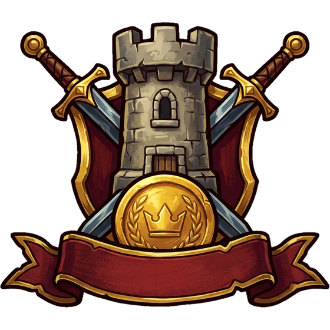

# Warriors & Wealth Wiki

[🇮🇹 Italiano](../IT/README.md) &nbsp;·&nbsp; [🏠 Home](../../README.md) &nbsp;·&nbsp; [▶️ Play now](https://milos.warriorsandwealth.com:8448/index.html)

Welcome to the official guide to **Warriors & Wealth**, the online medieval strategy game: every part of the game is explained step by step here, using the same names for tabs and buttons you see in the client. The same wiki is also available inside the game, from the player menu.

## 🧭 First steps

| Page | What it covers |
| --- | --- |
| [Welcome to Warriors & Wealth](Introduction.md) | What kind of game it is, how a session works, and where to find everything. |
| [Quick start](Quick-start.md) | Where to begin: how to find your way around, what to do in the first hours, the daily routine and the most common mistakes. |

## 🏘️ The village

| Page | What it covers |
| --- | --- |
| [Resources](Resources.md) | What the village produces, what it consumes, and how to balance stocks, upkeep and storage. |
| [Construction and buildings](Construction-and-buildings.md) | The structures of the village, how they are built, what they really cost and how the queues work. |
| [Army](Army.md) | The four troop classes, how they are trained, how much they cost to maintain and how traps work. |
| [Research and Technology](Research-and-Technology.md) | How to make the village and the army stronger: tiered research and the technology tree. |
| [Inventory and items](Inventory-and-items.md) | Consumable items: where to buy them, the six categories, the rules of timed bonuses and the special items. |

## 🗺️ The world

| Page | What it covers |
| --- | --- |
| [Kingdoms](Kingdoms.md) | The world is divided into small communities: find out what you share with your neighbors and how to move house. |
| [Barbarian Cities and Villages](Barbarian-Cities-and-Villages.md) | How the Barbarians are built: personal Villages and Kingdom Cities, the twenty-level ladder, the loot and the monthly renewal. |
| [Rallies](Rallies.md) | Joining the Kingdom's troops in a single assault: how to create one, how to join, what happens to whoever is in the crosshairs and how the loot is split. |

## ⚔️ War

| Page | What it covers |
| --- | --- |
| [The City and defense](The-City-and-defense.md) | The six defenses of the village: garrisons, traps, repairs and how to prepare for being attacked. |
| [PVE: Barbarians](PVE-Barbarians.md) | Barbarian Villages and Cities: how to attack, what you earn and how to climb the ladder of levels. |
| [PVP: challenging players](PVP-challenging-players.md) | Challenging other players in the Kingdom: who you can attack, how the clash unfolds, loot and limits. |
| [Espionage](Espionage.md) | Explore: what it costs, what it reveals and how to defend yourself from other people's espionage. |
| [Battle reports](Battle-reports.md) | How to read Reports: the list, the favorites and the detail of a clash, phase by phase. |

## 📈 Growth

| Page | What it covers |
| --- | --- |
| [Experience and levels](Experience-and-levels.md) | How Experience is earned, how you level up and what it is for. |
| [Monthly Quests](Monthly-Quests.md) | The goals of the month, the points bar and the rewards to claim. |
| [GamePass and daily rewards](GamePass-and-daily-rewards.md) | Silver and Gold: what they unlock, how rewards are claimed and why the streak must not be broken. |

## 💎 Economy

| Page | What it covers |
| --- | --- |
| [Shop and Diamonds](Shop-and-Diamonds.md) | Packs, items, currencies and payments: what you can buy and how. |
| [Fiefs and income](Fiefs-and-income.md) | How Fiefs are bought, how Tributes work and how they are exchanged or withdrawn. |

## ❓ Help

| Page | What it covers |
| --- | --- |
| [Glossary](Glossary.md) | The words of the game explained in a few lines, with a link to the page that covers them in depth. |
| [Frequently asked questions](FAQ.md) | Short answers to the most common questions about the village, battles, Diamonds and account. |
