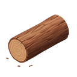
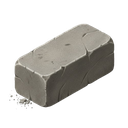
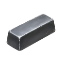
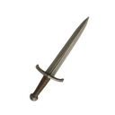
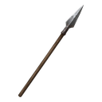
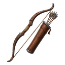
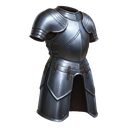

[📖 Wiki index](README.md) › 🏘️ The village &nbsp;·&nbsp; [🇮🇹 Italiano](../IT/Risorse.md)

# Resources

*What the village produces, what it consumes, and how to balance stocks, upkeep and storage.*

---

## The heart of the village

Everything you do in Warriors & Wealth has a price: building, training, researching, even keeping the army on its feet. Resources are the fuel for all of it, and understanding where they come from, where they stop and where they vanish is the difference between a village that grows calmly and one that jams right when you need it most.

You'll find them all in the **top bar**, always visible. The upper row has your name, the  **Level**, the  **Experience** and the **Diamonds**; the row below has the village resources, with a button to switch from the *civilian* group to the *military* one, and the  **Tributes**. Tapping any resource opens its card, with the explanation and the numbers updated in real time.

## Civilian resources

They are the economic engine: they come from the civil structures, pile up on their own over time and support almost every activity.

| Resource | Where it comes from | What it is for |
| --- | --- | --- |
|  **Food** | Farm | The price of many buildings and trainings, and above all the upkeep of the troops. |
|  **Wood** | Sawmill | The basic material of almost everything, indispensable from the very first steps. |
|  **Stone** | Stone Quarry | Structures and fortifications: the item that weighs the most when you build big. |
|  **Iron** | Iron Mine | Weapons, armor and more advanced units: it becomes more important as you grow. |
|  **Gold** | Gold Mine | Upkeep of troops and structures. It is often the real bottleneck. |
|  **Population** | Houses | Those who work, build and fight: every building, every soldier and every research needs a few. |

Food, wood, stone, iron and gold can also be **plundered**: Barbarian Cities and other players keep some, and whoever wins a battle takes home the loot (and whoever loses a defense leaves it on the field). Population, on the other hand, can't be stolen or won in battle: it only grows with Houses.

## How to read a resource card

Tap Food in the bar and look at what shows up. There are four lines that matter:

- **Production.** Two numbers side by side, always *per second*: the orange one is the **net** production (what actually comes in), the green one is the **gross** production (how much the structures produce before subtracting consumption).
- **Buildings.** How much your structures «eat» every second to keep running.
- **Army.** How much the troops cost, for all the units you own, even those deployed in defense. It only appears for  **Food** and  **Gold**, the two resources soldiers are «paid» with.
- **Limit.** How far that stock can go.

> [!TIP]
> **The first number to look at**
>
> Before building a new barracks or training a group of troops, open the Food and Gold cards and look at the **net** production. If it's already low, every new soldier will push it down even further.

## Storage and the limit

Every resource has a maximum stock **limit**, and the more production structures you own, the higher the limit goes: every extra Farm widens the Food storage, every Sawmill the Wood storage, and so on. When a stock reaches its limit, the production of that resource stops until you spend something.

This gives rise to a useful habit: don't leave the storages full for days. A resource sitting at its limit is wasted production, and a huge stock is also an inviting loot for whoever decides to attack you.

> [!NOTE]
> **Even when you're away**
>
> Production and consumption keep flowing **even if you're offline**. When you come back you find what has accumulated, but also what the troops and buildings have consumed in the meantime.

## Upkeep: the hidden cost of growth

Building a structure or training a unit is not a one-time payment: **units, Barracks and military structures have an upkeep** that is continuously deducted. Food and Gold are needed mostly by the troops; Barracks and Workshops in turn consume resources to stay operational.

As long as net production is positive you won't notice. If it turns negative, the stocks drop down to zero (they never go below) and at that point you can no longer build, train or research, right when you'd need one more Farm to fix things.

> [!WARNING]
> **Don't underestimate it**
>
> A huge army that the village can't sustain slows growth instead of speeding it up. Grow in balance: every time you add troops or military structures, check that the net production of Food and Gold still holds. If you find yourself struggling, Barbarian Cities and Barbarian Villages are a way to get the stocks moving again.

## Military resources

An army is not equipped with gold: weapons are **produced**, in the Workshops. The military group is hidden behind the switch button in the bar, next to the civilian resources.

| Resource | Structure that produces it | Role |
| --- | --- | --- |
|  **Swords** | Sword Workshop | Basic equipment of many units. |
|  **Spears** | Spear Workshop | The Spearmen's weapon. |
|  **Bows** | Bow Workshop | Needed to train Archers. |
|  **Shields** | Shield Workshop | They strengthen the resilience of many units. |
|  **Armor** | Armor Workshop | Defensive equipment of the troops. |
|  **Arrows** | Arrow Workshop | Ammunition of ranged units. |

The most important difference from civilian resources is how they are *used*. Swords, Spears, Bows, Shields and Armor are spent when you **train** the units that require them. **Arrows** are different: they are ammunition, and the ones you need are consumed **during battles**. If you don't have enough, ranged units fight far below their value. That is why an Arrow Workshop is not optional for anyone relying on Archers and Catapults.

Military resources also have a **storage limit**, which grows with the number of Workshops of the matching type, and on the card of each one you find its production per second. The details of what each unit needs are on the [Army](Army.md) page.

## Rare resources

They are the game's «premium currency». They don't come out of buildings: they are earned.

- **Blue Diamonds.** They are the most common and the most versatile. They are used to **speed up** construction, training and traps (the *Speed up* button tells you how much time each diamond removes) and to buy in the Shop. You earn them by playing: battles, Quests, GamePass.
- **Purple Diamonds.** The rarest and most precious. They are used for the important things, like the Kingdom change, and Barbarian Cities are one of the few sources to earn them by playing, with limits designed to distribute them fairly (the [Kingdoms](Kingdoms.md) page talks about it). There is also an exchange between Purple and Blue: you read the rate on the exchange screen.
- **Tributes.** They don't come from battles: **Fiefs** produce them, over time, according to their rarity. They are the «income» of your village and, unlike Diamonds, they can't be plundered. Important note: the generation of Tributes is a service that Warriors & Wealth commits to keeping active as long as possible, but it is not guaranteed forever: we reserve the right to change or remove it, even though the intention is to always keep it on. In the **Fiefs** tab of the Overview you also find their exchange into Purple Diamonds.

> [!WARNING]
> **Careful during wars**
>
> Your **Diamond** stocks can be lost if you suffer an attack that goes badly in defense, within the limits set by the PVP rules. Don't leave large amounts idle if you know you're a target: spend them well, or protect the village.

## Frequently asked questions

<b>Why am I not producing anything anymore?</b>

Almost always a resource has reached its **limit**: spend it and production restarts. Open the resource card from the top bar to see it.

<b>My stocks keep dropping even if I don't spend anything: is that normal?</b>

Yes, if the **net** production is negative: troops and structures consume more than you produce. Build more production structures or reduce consumption before the stocks reach zero.

<b>Can Population be plundered?</b>

No: it only grows with Houses and is spent by building, training and researching.

<b>What happens to my storages when I'm offline?</b>

They keep filling (up to the limit) and being consumed as usual. The village remains attackable, so a full storage weighs as much as a weak army.

<b>Where do I see how much a structure or a unit costs me?</b>

In the [Construction](Construction-and-buildings.md) and Training screens, by pressing the **i** button of the row: cost, time and effect appear, already multiplied by the quantity you chose.

---

⬅️ [Previous: Quick start](Quick-start.md) &nbsp;·&nbsp; [📖 Wiki index](README.md) &nbsp;·&nbsp; [Next: Construction and buildings](Construction-and-buildings.md) ➡️
