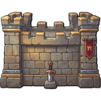
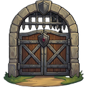
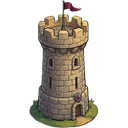
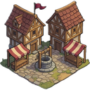
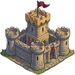

[📖 Wiki index](README.md) › ⚔️ War &nbsp;·&nbsp; [🇮🇹 Italiano](../IT/La-Citta-e-la-difesa.md)

# The City and defense

*The six defenses of the village: garrisons, traps, repairs and how to prepare for being attacked.*

---

## Six layers between the enemy and your village

Whoever decides to attack you can't simply walk into your home: they must open a path through six defenses, one after the other, and only at the end do they reach the actual **Village**, where the troops you haven't assigned to any structure are. Each defense has a number, the *defensive layer*, which you see in the round medallion of its card: the lower the number, the closer the structure is to the enemy.

| Layer | Structure | What it has |
| --- | --- | --- |
| 1 |  **Entrance** | A **Garrison** and a space for **Traps**. It has no Health or Defense points of its own: it's the first place where the enemy meets soldiers. |
| 2 |  **Walls** | **Health**, **Defense**, **Garrison** and space for **Traps**. |
| 3 |  **Gate** | **Health**, **Defense** and **Garrison**. |
| 4 |  **Towers** | **Health**, **Defense** and **Garrison**. |
| 5 |  **Center** | Only the **Garrison**: it's the last courtyard before the Castle. |
| 6 |  **Castle** | **Health**, **Defense** and **Garrison**. Falling here means the enemy is at your doorstep. |

How the clash unfolds in each layer, and how soldiers and structures face each other, is told in [PVP: challenging players](PVP-challenging-players.md). Here we deal with your side of the barricade: how to prepare.

## The City screen

Open the **City** tab in the bottom bar. At the top there is the **village overview**, an image with six numbered markers: when a structure needs attention, its dot blinks. Tapping it scrolls you to the matching card in the list below. Each card shows:

- the **name** of the structure and a status line: *Intact*, *Damaged*, *Under repair* or *Critical!*, with the border changing color accordingly;
- the **Health** (*HP*) and **Defense** (*DEF*) bars, where the structure has them;
- the **Garrison** bar and, for Entrance and Walls, the **Traps** one.

## The Garrison: who defends what

The troops in the village don't defend any structure in particular: they only fight in the last clash, the one played inside the **Village**. To defend a layer you must **assign soldiers to it**, and that is where you decide how to keep the fortress standing.

1. On the structure's card press **Garrison**: the move panel opens.
2. Choose the direction with the two buttons: **To (the structure)** to reinforce it, **To Village** to recall the soldiers home.
3. Choose the troop level with the **I – V** keys and, with **+** and **−**, how many soldiers of each class to move. The quantities stay in memory even when you change level: a single submission moves everything.
4. Press **Move**.

Each structure has a number of garrison **places**: you see it on the bar and the game reminds you how many are left. The limit applies to the total number of soldiers, of any class and level. Recalling troops to the Village, instead, has no limits. Increasing the places is the job of [Research](Research-and-Technology.md), in the **City** panel.

> [!NOTE]
> **A soldier is never free**
>
> Whoever is assigned to a structure keeps costing  **Food** and  **Gold** like any other and keeps taking up their place in the Barracks: the [Army](Army.md) page talks about it. You no longer see them among the free troops of the village, but you always pay for them.

## Traps

**Traps** (**Caltrops, Hedgehogs, Pavises, Greek Fire, Ballistae**) aren't trained: you build them with the **Trap Workshop** and then you **deploy** them where they're needed. On the card of a structure that supports them you find the traps bar and the dedicated button, with a list of the types you've unlocked or already own.

- **Deploy.** Choose how many traps of each type to take from the village and press **Deploy**. The limit is the free space of the structure, which you can widen with the *Traps* research.
- **They can't be withdrawn.** Once deployed, a trap stays where it is: the game reminds you every time. Think carefully about where to put them.
- **They go off on their own.** When an enemy attacks that structure, the traps hit the attackers and, by going off, they are *destroyed*. After a siege they must therefore be rebuilt and redeployed. The battle Report tells you how many went off and how many remain.

## Repairing the defenses

A defense that gets hit loses Health and Defense and doesn't recover them on its own. When a bar is below the maximum, the **Repair** button appears next to it: pressing it starts the repair of *that* bar.

- **One step at a time.** Repair proceeds at regular intervals: at each step the structure recovers a part of its points and the game deducts the necessary resources from your storage. The *Repair* research and Technology make each step more effective, and Technology also shortens the wait between one step and the next.
- **It stops on its own.** When the bar is full, or when the resources for the next step are missing. If you notice a repair has stopped, check your stocks and restart it.
- **Repair All.** When at least two bars are damaged a notice appears at the top with the number of structures to fix and the **Repair All** button, which starts them all at once.
- **Stop all repairs.** If one or more repairs are in progress, you also find at the top the button to interrupt them immediately. Useful when stocks are running low and you don't want to consume them further.

> [!WARNING]
> **When a bar hits zero**
>
> The status becomes **Critical!** and the dot on the overview blinks differently from the other signals. It's time to step in: a structure on the ground no longer protects you, and the next attacker knows it.

Entrance and Center have no Health and Defense bars: they are defenses made exclusively of soldiers, and there is nothing to repair.

## How to think about defense

> [!TIP]
> **Don't scatter your forces**
>
> An army spread evenly across six layers is weak everywhere. It's usually better to concentrate: a few really solid layers, perhaps the ones that already have Health and Defense bars you can count on, instead of six mediocre layers. **Traps** are especially useful in the first layers, to reduce the number of assailants before they reach the melee. And keep some soldiers in the **Village**: it's the last clash, the one that decides whether the enemy takes the loot away.

Also remember that defense doesn't live on soldiers alone: the **Health** and **Defense** of the structures, the capacity of the garrisons and the traps improve with [Research](Research-and-Technology.md), and the  **VIP** bonuses add to the statistics of your troops.

## Frequently asked questions

<b>If I assign no troops to the structures, am I defenseless?</b>

Not completely: the troops left in the Village defend the last clash. But the previous layers will be crossed without resistance, and only the traps and the structures' statistics will try to slow the attacker down.

<b>Can I move troops while under attack?</b>

Battles are resolved in an instant, so there's no way to intervene once the clash has started: what counts is how you left the village. Check the garrisons before closing the game.

<b>Why don't I see the Repair button?</b>

It only appears when the Health or Defense bar is below the maximum. If the structure is intact, or is one of those without bars (Entrance and Center), there's nothing to repair.

<b>Can I withdraw the traps I've deployed?</b>

No. A deployed trap stays in the structure until it goes off during an attack.

<b>Where do I see the cost of repairs?</b>

The necessary resources are deducted from your storage at each step: keep an eye on your stocks from the top bar while the repair proceeds.

---

⬅️ [Previous: Rallies](Rallies.md) &nbsp;·&nbsp; [📖 Wiki index](README.md) &nbsp;·&nbsp; [Next: PVE: Barbarians](PVE-Barbarians.md) ➡️
