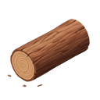
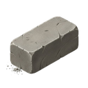
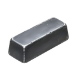

[📖 Indice della wiki](README.md) › 🗺️ Il mondo &nbsp;·&nbsp; [🇬🇧 English](../EN/Barbarian-Cities-and-Villages.md)

# Città e Villaggi Barbari

*Come sono fatti i Barbari: Villaggi personali e Città del Regno, la scala dei venti livelli, il bottino e il rinnovo mensile.*

---

## Il nemico sempre disponibile

I **Barbari** non sono giocatori. Nessuno li governa, nessuno li aiuta e non rispondono a nessuno: sono il nemico fisso del mondo, sempre lì quando hai truppe da provare e risorse da guadagnare. Questa pagina racconta *come sono fatti*; come si attaccano, passo per passo, lo spiega [PVE: Barbari](PVE-Barbari.md).

## Due famiglie, due modi di giocare

| Villaggio | Città |
| --- | --- |
| Un accampamento **personale**: ne ha uno ciascun giocatore, e nessun altro può toccare il tuo. Si adatta a *te*: i suoi difensori e le sue scorte si misurano sul tuo livello al momento del rinnovo. È la palestra di tutti i giorni, a basso rischio. | Una fortezza **condivisa** da tutto il Regno. Le guarnigioni sono più numerose, le scorte molto più ricche e, soltanto qui, c'è la possibilità di guadagnare  **Diamanti Viola**. Si adatta al *Regno*: più sono forti i suoi giocatori migliori, più le sue Città sono dure e generose. |

## La scala dei venti livelli

Sia i Villaggi sia le Città sono una **scala di venti livelli**, dal più facile al più duro. Si sale un gradino alla volta: il livello successivo compare solo dopo aver sconfitto il precedente. Il livello decide due cose distinte:

- **Quanto sono forti i singoli soldati.** Ogni livello schiera le quattro classi (**Guerrieri, Lanceri, Arcieri, Catapulte**) tutte allo stesso livello di addestramento, e più sali nella scala, più quel livello è alto: i Barbari dei gradini superiori sono equipaggiati meglio di quelli iniziali. Le loro statistiche precise le leggi nel Report, nella sezione *Statistiche Truppe Barbare* (vedi [Report di battaglia](Report-di-battaglia.md)).
- **Quanti sono.** La guarnigione cresce gradino dopo gradino, e più ancora per le Città che per i Villaggi.

Anche il bottino segue la scala: più il livello è alto, più le scorte sono ricche, e così l' **Esperienza** che si guadagna sconfiggendoli. Quindi non c'è fretta: salire la scala è proprio il modo in cui il tuo esercito cresce insieme alle sfide.

## Cosa custodiscono

|  | Villaggio | Città |
| --- | --- | --- |
| Risorse civili |  **Cibo**,  **Legno**,  **Pietra**,  **Ferro**,  **Oro** | Le stesse cinque, in quantità molto maggiori |
|  **Diamanti Blu** | Sì | Sì, in quantità molto maggiori |
|  **Diamanti Viola** | No | Sì, con limiti settimanali per giocatore |
| A chi appartiene il bottino | Solo a te | A tutto il Regno: chi lo preleva lo toglie agli altri |

Le scorte non sono infinite: quello che porti via esce dal magazzino del bersaglio e lì non c'è più, nemmeno per i tuoi compagni di Regno nel caso delle Città. Ne parla anche la pagina [Regni](Regni.md), con tutto quello che vale la pena sapere sui Diamanti Viola.

## Ferite che restano

I Barbari non si ricostruiscono dopo ogni scontro. Se non li elimini tutti, i sopravvissuti restano com'erano e li ritrovi così al prossimo attacco, tuo o di chiunque altro nel caso di una Città. Solo le barre di Salute e Difesa della struttura risalgono, lentamente, col passare del tempo. Ecco perché le Città si prestano al lavoro di squadra: un giocatore le consuma, un altro le finisce, e i [Raduni](Raduni.md) servono proprio a questo.

## Il rinnovo mensile

Una volta al mese, il primo giorno, il mondo barbaro si rinnova. Le Città tornano nuove, con difese e scorte al massimo e calibrate sulla forza attuale del Regno. I tuoi Villaggi ripartono dal gradino più basso, ricalcolati sul tuo livello di allora. Chi aveva completato la scala la ricomincia, ma con avversari tarati sulla sua forza di adesso: è il modo in cui il gioco evita che i Barbari diventino troppo facili o troppo duri col passare dei mesi.

> [!TIP]
> **Il momento giusto**
>
> Se hai ancora bottino da prendere su un livello già sconfitto, non rimandare oltre il rinnovo: poi si ricomincia. In compenso, subito dopo il rinnovo le Città sono intatte e al massimo delle scorte, il momento migliore per organizzare un [Raduno](Raduni.md).

## Domande frequenti

<b>Perché ogni mese i miei Villaggi ricominciano da capo?</b>

Perché la scala si rinnova insieme al mondo. Ripartire dal basso non cancella nulla di quello che hai guadagnato: resta tutto nel tuo villaggio, e i nuovi gradini sono tarati sul tuo livello di adesso.

<b>Posso saltare un livello?</b>

No. Il successivo si apre solo dopo aver sconfitto quello precedente, sia nei Villaggi sia nelle Città.

<b>Se cambio Regno cosa succede ai miei Villaggi?</b>

Restano tuoi, identici. Cambiano invece le Città, che sono quelle del nuovo Regno.

<b>Quale conviene: Villaggio o Città?</b>

I Villaggi sono la scelta sicura quando vuoi provare l'esercito o recuperare risorse con calma. Le Città sono più ricche, ma più dure e condivise: conviene attaccarle con un esercito ben preparato o in gruppo.

---

⬅️ [Precedente: Regni](Regni.md) &nbsp;·&nbsp; [📖 Indice della wiki](README.md) &nbsp;·&nbsp; [Successiva: Raduni](Raduni.md) ➡️
