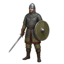
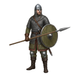

[📖 Indice della wiki](README.md) › 🏘️ Il villaggio &nbsp;·&nbsp; [🇬🇧 English](../EN/Army.md)

# Esercito

*Le quattro classi di truppe, come si addestrano, quanto costano da mantenere e come funzionano le trappole.*

---

## Quattro classi, un solo esercito

Le tue truppe sono la parte più viva del villaggio: difendono quando sei lontano, attaccano quando decidi di muoverti e, nel frattempo, si fanno pagare. Il gioco ne conosce quattro classi, ciascuna con il suo carattere.

- <b> Guerrieri</b> — La fanteria di base: equilibrati in tutto, senza punti deboli evidenti. Una scelta sicura in ogni fase della partita.
- <b> Lancieri</b> — Un po' più resistenti e capaci di trasportare di più. Sono la spina dorsale di chi vuole truppe che reggono il colpo.
- <b> Arcieri</b> — Colpiscono forte e da lontano, ma sono fragili in difesa. Consumano  **Frecce** durante le battaglie.
- <b> Catapulte</b> — Le unità più potenti e quelle che portano più bottino. Costano parecchio in risorse e Popolazione, e anche loro vivono di Frecce.

Ogni classe esiste in **cinque livelli** (I–V): salendo di livello salgono Salute, Attacco, Difesa e Zaino (cioè quanto bottino può portare). I valori esatti sono nella schermata **Addestramento** e possono essere ritoccati nel tempo: quello che vedi lì è la verità.

## I livelli si sbloccano con la Tecnologia

All'inizio hai a disposizione solo le unità di **livello I**. Per le altre non serve salire di livello giocatore: serve la [Tecnologia](Ricerca-e-Tecnologia.md), dove ogni sotto-ricerca contiene uno *sblocco* che apre il livello successivo, per tutte e quattro le classi. In Addestramento i pulsanti **I – II – III – IV – V** mostrano quali livelli hai già aperto (con un ✓) e quali sono ancora chiusi (con un 🔒).

## Addestrare le truppe

1. Apri **Costruzione → Addestramento**.
2. Scegli il livello con i pulsanti **I – V**: le righe mostrano le quattro classi di quel livello.
3. Con **+** e **−** decidi quante unità addestrare per ciascuna classe. Il pulsante **i** mostra costo, tempo e statistiche, già moltiplicati per la quantità scelta.
4. Premi **Recluta**: l'ordine parte tutto insieme.

Perché l'addestramento riesca, devono essere vere **tutte** queste condizioni:

| Serve | Perché |
| --- | --- |
| Una **Caserma** della classe giusta | Senza Caserma Guerrieri non addestri Guerrieri, e così per le altre. |
| Un livello **sbloccato** | I livelli II–V si aprono con la Tecnologia. |
| **Posto libero** in Caserma | Ogni classe ha un limite massimo, deciso dal numero di Caserme. |
| **Risorse** e  **Popolazione** | Le paghi tutte subito, anche per le unità che aspettano in coda. |
| L'**equipaggiamento** richiesto | Spade, Lance, Archi, Scudi o Armature, a seconda dell'unità: il pulsante **i** ti dice cosa serve. |

Il gioco controlla tutto prima di iniziare: se manca qualcosa, quella classe non parte e non paghi nulla. Il Log ti dice se hai finito i posti in Caserma, se il livello non è ancora sbloccato o se le risorse non bastano. Se addestri più classi insieme, ognuna viene valutata da sola: partono quelle che hanno tutto.

## Il limite della Caserma

Ogni classe ha un **limite massimo** di truppe, e quel limite dipende da quante Caserme di quel tipo possiedi. Le Caserme non si potenziano: se vuoi più posti, ne costruisci un'altra (ricorda che hanno un mantenimento).

Nel conteggio entrano **tutte** le unità di quella classe: quelle nel villaggio, quelle in coda o in addestramento e anche quelle **schierate nelle difese della Città**. Una truppa spostata in un presidio occupa comunque il suo posto in Caserma. Nella Panoramica, tab **Esercito**, ogni barra lo mostra con due colori: la parte **verde** sono le unità presenti nel villaggio (il numero scritto è quello), la parte **arancione** quelle dello stesso livello schierate nelle difese.

## Le code: Reclutatori

Quante unità vengono addestrate *nello stesso momento* lo decidono i tuoi **Reclutatori**, che vedi nella Panoramica, tab **Esercito**. Ne hai uno di base; altri arrivano con i pacchetti del Negozio e con certi oggetti. Le unità che superano i Reclutatori aspettano il loro turno e partono da sole.

- **Velocizza.** Con i  **Diamanti Blu** riduci il tempo di addestramento: il gioco ti mostra in anteprima quanto.
- **Annulla addestramenti in coda.** Cancella le unità *non ancora iniziate* e rimborsa solo una parte del costo (la conferma ti dice quanto).
- **Licenzia.** Il cestino in fondo alla scheda di un'unità in Panoramica ne elimina un certo numero. **Non restituisce nulla**, e funziona solo sulle unità libere nel villaggio: quelle schierate nelle difese vanno prima richiamate. È l'unico modo per fare spazio quando devi demolire una Caserma.

I tempi di addestramento si accorciano anche con la [Ricerca](Ricerca-e-Tecnologia.md) (*Addestramento*), con la Tecnologia e con il bonus del VIP.

## Il costo di mantenere un esercito

Le truppe costano  **Cibo** e  **Oro** ogni secondo, tutte, comprese quelle ferme a guardia della Città. Per questo la scheda di Cibo e Oro ha una riga *Esercito*. Più numerosa e avanzata è la tua armata, più pesa. Prima di arruolare, controlla la produzione **netta**: ne parliamo in [Risorse](Risorse.md).

> [!WARNING]
> **Il classico errore**
>
> Un esercito addestrato in un momento di entusiasmo e poi lasciato a consumare. Se la produzione netta di Cibo o Oro va sotto zero, le scorte si svuotano e non riesci più a costruire neppure la Fattoria che servirebbe a rimediare. Meglio una truppa meno numerosa e sostenibile.

## Le Trappole

Sono difese che non si addestrano: si **costruiscono**, e lavorano in silenzio finché qualcuno non attacca il tuo villaggio. Esistono cinque tipi, dal più semplice al più micidiale: **Triboli, Porcospino, Pavesi, Fuoco Greco e Baliste**.

- **Per costruirle** ti serve almeno un'**Officina Trappole** (Costruzione → Edifici → Strutture Militari). Dopo, le ordini da **Costruzione → Addestramento**, nella sezione *Trappole*, con il pulsante **Costruisci trappole**.
- **Quanti tipi** puoi usare lo decide la [Tecnologia](Ricerca-e-Tecnologia.md): ogni tipo oltre il primo ha il suo sblocco.
- **Quante** ne puoi avere dipende dal numero di Officine Trappole: il totale comprende quelle pronte, quelle in costruzione e quelle già schierate.
- **Trappolieri.** Sono la tua coda di costruzione trappole: uno di base, uno in più con il pacchetto dedicato del Negozio.
- **Dove stanno.** Una volta pronte vanno schierate nelle difese della Città (*Ingresso* e *Mura*) dalla schermata **Città**. Quanto spazio hanno lo aumenta la [Ricerca](Ricerca-e-Tecnologia.md) *Trappole*.
- **In Panoramica**, nel tab Esercito, il selettore **Esercito / Trappole** ti fa vedere le tue trappole, con barre di avanzamento, *Velocizza*, *Annulla trappole in coda* e il cestino per eliminarle (anche qui, senza rimborso).

Come si comportano durante un assedio lo spiega la guida alla difesa della Città.

## Domande frequenti

<b>Non riesco ad addestrare una classe: perché?</b>

Controlla le condizioni nella tabella sopra. I due motivi più frequenti sono la Caserma che manca (o già al limite) e un livello ancora bloccato dalla Tecnologia.

<b>Una truppa schierata in difesa occupa posto in Caserma?</b>

Sì: conta sempre, anche se non è più nel villaggio. Per questo la barra della Panoramica ha una parte arancione.

<b>Quale classe conviene addestrare per prima?</b>

Dipende da come vuoi giocare. I Guerrieri sono la scelta più facile per cominciare; chi punta sulla difesa ama i Lancieri; chi vuole colpire forte investe in Arcieri e Catapulte, ricordando però di avere un'Officina Frecce.

<b>Posso riavere le risorse se licenzio un'unità?</b>

No. Il licenziamento non rimborsa nulla. Lo si usa per fare spazio o alleggerire il mantenimento.

<b>Dove vedo le statistiche delle mie truppe?</b>

Nella schermata Addestramento (pulsante **i** dell'unità) e nel tab **Statistiche**, dove trovi anche i bonus che stai accumulando con Ricerca e Tecnologia.

---

⬅️ [Precedente: Costruzione ed edifici](Costruzione-ed-edifici.md) &nbsp;·&nbsp; [📖 Indice della wiki](README.md) &nbsp;·&nbsp; [Successiva: Ricerca e Tecnologia](Ricerca-e-Tecnologia.md) ➡️
