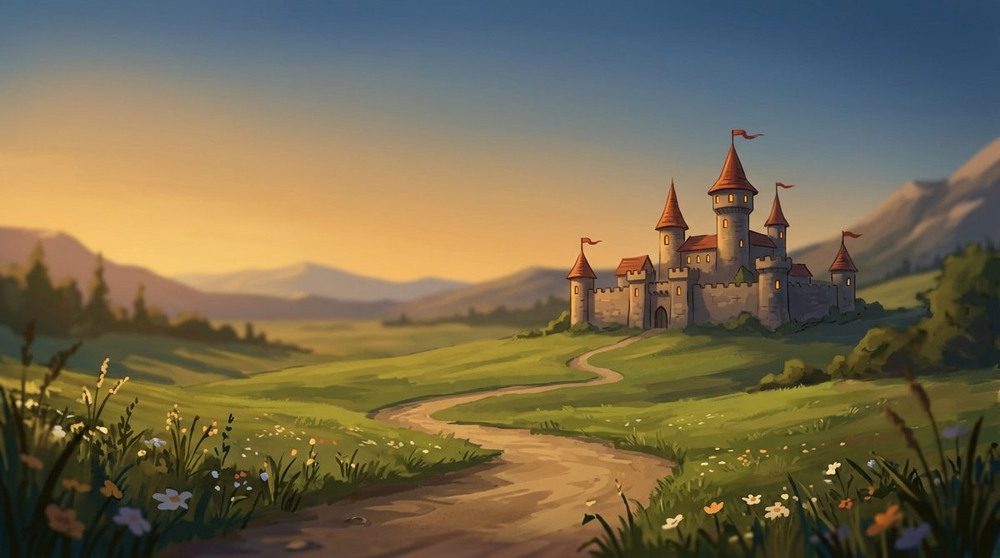

[📖 Indice della wiki](README.md) › 🧭 Primi passi &nbsp;·&nbsp; [🇬🇧 English](../EN/Introduction.md)

# Benvenuto in Warriors & Wealth

*Che gioco è, come funziona una partita e dove trovare ogni cosa.*

---

## Il gioco in breve

**Warriors & Wealth** è uno strategico medievale online. Parti da un piccolo villaggio e lo fai crescere: costruisci, ricerchi, addestri un esercito e con quello affronti le Città Barbare e gli altri giocatori del tuo Regno. Non servono riflessi fulminei: contano il calcolo, la pazienza e la capacità di coordinarti con gli altri.

Il tuo villaggio non si ferma quando esci: le risorse continuano a produrre anche mentre non ci sei. Questo significa però che può essere attaccato anche da offline, ed è per questo che la difesa e lo *Scudo della Pace* contano quanto l'attacco.

## Come si svolge una partita

Non c'è un unico modo di giocare, ma quasi tutto ruota attorno a questo ciclo.

1. **Produci.** Fattorie, segherie, cave e miniere forniscono le risorse; le abitazioni ospitano la popolazione che serve per costruire e per addestrare.
2. **Costruisci.** Ogni edificio potenziato rende il villaggio più forte, ma richiede risorse e tempo. Più code hai, più cose puoi fare insieme.
3. **Ricerca.** Le tecnologie migliorano produzione, truppe e difese, e molte hanno un livello minimo da raggiungere.
4. **Addestra.** Guerrieri, Lancieri, Arcieri e Catapulte nascono nelle Caserme e costano risorse e popolazione, ma anche mantenimento.
5. **Difendi.** Schiera le truppe nelle strutture della tua Città: sono loro a fermare chi viene a saccheggiarti.
6. **Combatti.** Attacca Villaggi e Città Barbare, sfida altri giocatori nel PVP o unisciti a un Raduno. Vincere dà bottino ed esperienza.
7. **Cresci.** L'esperienza ti fa salire di livello, e il livello apre ricerche, difese e battaglie nuove. Poi si ricomincia, con più forza.

## Le risorse

Il gioco si regge su **cinque risorse civili** (cibo, legno, pietra, ferro e oro) più la  **popolazione**. Per equipaggiare l'esercito servono anche le **risorse militari**, come Spade, Lance, Archi, Scudi, Armature e Frecce. A queste si aggiungono i **Diamanti**: i Blu servono soprattutto ad accelerare i tempi, i Viola sono i più rari e preziosi. Ogni risorsa ha una guida dedicata in questa wiki.

## Dove trovo cosa

In basso trovi le schede principali del gioco. Il tuo nome, in alto, apre invece il **menu giocatore**.

| Scheda | A cosa serve |
| --- | --- |
| Panoramica | Il quadro generale del tuo villaggio, con le notizie degli ultimi eventi. |
| Costruzione | Gli edifici da costruire e potenziare, l'addestramento delle truppe e le trappole. |
| Città | La parte fortificata del villaggio: qui schieri le truppe nelle strutture difensive e le ripari dopo un assedio. |
| Negozio | Acquisti in Diamanti, compresi gli oggetti che trovi poi nell'Inventario. |
| Ricerca | Le tecnologie che migliorano strutture, eserciti e strategie. |
| Tecnologia | L'albero dei bonus permanenti, che si sblocca salendo di livello. |
| Statistiche | Potenza, bonus e potenziamenti attivi, con il tempo che resta a quelli temporanei. |
| Inventario | Gli oggetti che possiedi e i bonus a tempo attivi. |
| PVP/PVE | Esplorare i nemici, attaccarli, organizzare i Raduni e rileggere i Report. |
| GamePass | I premi giornalieri. |
| Quest Mensili | Le missioni del mese, con punti e ricompense. |

Il menu giocatore raccoglie le cose che riguardano *te* più che il villaggio: il cambio di villaggio, l'immagine del profilo, i [Regni](Regni.md), questa Wiki, le opzioni di sicurezza e la privacy policy.

## Prima di tutto: calma

> [!TIP]
> **Consiglio**
>
> All'inizio il modo migliore per crescere è non avere fretta di combattere. Rinforza la produzione, tieni sempre qualcosa in costruzione e in ricerca, e solo dopo pensa all'esercito. Quando attacchi, *esplora prima di colpire*: sapere cosa ti aspetta vale più di mille soldati in più.

## Come leggere questa wiki

> [!NOTE]
> **Una nota sui numeri**
>
> La wiki spiega le regole del gioco così come sono, con i nomi esatti delle schede e dei pulsanti che vedi sullo schermo. I valori precisi (costi, tempi, limiti) possono essere ritoccati nel tempo: per questo, quando un numero conta, ti diciamo dove guardarlo nel gioco. Quello che vedi nel client è sempre la verità.

Se non sai da dove iniziare, scorri l'indice: ogni pagina è pensata per essere letta da sola, e quando ne serve un'altra c'è il collegamento. Puoi anche usare la ricerca in alto.

---

[📖 Indice della wiki](README.md) &nbsp;·&nbsp; [Successiva: Guida rapida](Guida-rapida.md) ➡️
