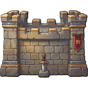
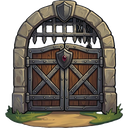
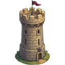
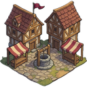
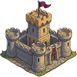

[📖 Indice della wiki](README.md) › ⚔️ La guerra &nbsp;·&nbsp; [🇬🇧 English](../EN/The-City-and-defense.md)

# La Città e la difesa

*Le sei difese del villaggio: guarnigioni, trappole, riparazioni e come prepararsi a essere attaccati.*

---

## Sei strati tra il nemico e il tuo villaggio

Chi decide di attaccarti non può semplicemente entrare in casa tua: deve aprirsi la strada attraverso sei difese, una dopo l'altra, e solo alla fine arriva al **Villaggio** vero e proprio, dove stanno le truppe che non hai assegnato a nessuna struttura. Ogni difesa ha un numero, lo *strato difensivo*, che vedi nel medaglione tondo della sua scheda: più il numero è basso, più la struttura è vicina al nemico.

| Strato | Struttura | Cosa possiede |
| --- | --- | --- |
| 1 |  **Ingresso** | Una **Guarnigione** e uno spazio per le **Trappole**. Non ha punti di Salute né di Difesa propri: è il primo posto dove il nemico incontra dei soldati. |
| 2 |  **Mura** | **Salute**, **Difesa**, **Guarnigione** e spazio per le **Trappole**. |
| 3 |  **Cancello** | **Salute**, **Difesa** e **Guarnigione**. |
| 4 |  **Torri** | **Salute**, **Difesa** e **Guarnigione**. |
| 5 |  **Centro** | Solo la **Guarnigione**: è l'ultimo cortile prima del Castello. |
| 6 |  **Castello** | **Salute**, **Difesa** e **Guarnigione**. Cadere qui significa che il nemico è alle porte di casa. |

Come si svolge lo scontro in ciascuno strato, e come soldati e strutture si affrontano, lo racconta [PVP: sfidare i giocatori](PVP-sfidare-i-giocatori.md). Qui ci occupiamo del tuo lato della barricata: come prepararti.

## La schermata Città

Apri la scheda **Città** nella barra in basso. In alto c'è la **panoramica del villaggio**, un'immagine con sei segnaposto numerati: quando una struttura ha bisogno di attenzione, il suo pallino lampeggia. Toccandolo scorri alla scheda corrispondente nell'elenco sotto. Ogni scheda mostra:

- il **nome** della struttura e una riga di stato: *Integra*, *Danneggiata*, *In riparazione* oppure *Critica!*, con il bordo che cambia colore di conseguenza;
- le barre di **Salute** (*HP*) e **Difesa** (*DEF*), dove la struttura le possiede;
- la barra della **Guarnigione** e, per Ingresso e Mura, quella delle **Trappole**.

## La Guarnigione: chi difende cosa

Le truppe nel villaggio non difendono nessuna struttura in particolare: combattono soltanto nell'ultimo scontro, quello che si gioca dentro il **Villaggio**. Per difendere uno strato devi **assegnarvi dei soldati**, ed è lì che si decide come tenere in piedi la fortezza.

1. Nella scheda della struttura premi **Guarnigione**: si apre il pannello di spostamento.
2. Scegli la direzione con i due pulsanti: **Verso (la struttura)** per rinforzarla, **Verso Villaggio** per richiamare i soldati a casa.
3. Scegli il livello delle truppe con i tasti **I – V** e, con **+** e **−**, quanti soldati di ciascuna classe spostare. Le quantità restano in memoria anche cambiando livello: un solo invio sposta tutto.
4. Premi **Sposta**.

Ogni struttura ha un numero di **posti** in guarnigione: lo vedi sulla barra e il gioco ti ricorda quanti ne restano. Il limite vale per il totale dei soldati, di qualsiasi classe e livello. Richiamare le truppe verso il Villaggio, invece, non ha limiti. Aumentare i posti è compito della [Ricerca](Ricerca-e-Tecnologia.md), nel pannello **Città**.

> [!NOTE]
> **Un soldato non è mai gratis**
>
> Chi è assegnato a una struttura continua a costare  **Cibo** e  **Oro** come ogni altro e continua a occupare il suo posto in Caserma: ne parla la pagina [Esercito](Esercito.md). Non lo vedi più tra le truppe libere del villaggio, ma lo paghi sempre.

## Trappole

Le **Trappole** (**Triboli, Porcospino, Pavesi, Fuoco Greco, Baliste**) non si addestrano: le costruisci con l'**Officina Trappole** e poi le **schieri** dove servono. Nella scheda di una struttura che le prevede trovi la barra delle trappole e il pulsante dedicato, con un elenco dei tipi che hai sbloccato o che già possiedi.

- **Schiera.** Scegli quante trappole di ciascun tipo prelevare dal villaggio e premi **Schiera**. Il limite è lo spazio libero della struttura, che puoi allargare con la ricerca *Trappole*.
- **Non si ritirano.** Una volta schierata, una trappola resta dov'è: il gioco te lo ricorda ogni volta. Pensa bene a dove metterle.
- **Scattano da sole.** Quando un nemico attacca quella struttura, le trappole colpiscono gli attaccanti e, scattando, si *distruggono*. Dopo un assedio vanno quindi ricostruite e riposizionate. Il Report della battaglia ti dice quante ne sono scattate e quante ne restano.

## Riparare le difese

Una difesa colpita perde Salute e Difesa e non le recupera da sola. Quando una barra è sotto il massimo compare, accanto, il pulsante **Ripara**: premendolo avvii la riparazione di *quella* barra.

- **Un passo alla volta.** La riparazione procede a intervalli regolari: a ogni passo la struttura recupera una parte di punti e il gioco scala dal tuo magazzino le risorse necessarie. La ricerca *Ripara* e la Tecnologia rendono ogni passo più efficace, e la Tecnologia accorcia anche l'attesa tra un passo e l'altro.
- **Si ferma da sola.** Quando la barra è piena, oppure quando mancano le risorse per il passo successivo. Se ti accorgi che una riparazione si è fermata, controlla le scorte e rilancia.
- **Ripara Tutto.** Quando almeno due barre sono danneggiate compare in alto un avviso con il numero di strutture da sistemare e il pulsante **Ripara Tutto**, che le avvia in un colpo solo.
- **Ferma tutte le riparazioni.** Se una o più riparazioni sono in corso, trovi in alto anche il pulsante per interromperle subito. Utile quando le scorte stanno finendo e non vuoi consumarle ancora.

> [!WARNING]
> **Quando una barra tocca lo zero**
>
> Lo stato diventa **Critica!** e il pallino sulla panoramica lampeggia in modo diverso dalle altre segnalazioni. È il momento di intervenire: una struttura a terra non ti protegge più, e il prossimo attaccante lo sa.

Ingresso e Centro non hanno barre di Salute e Difesa: sono difese fatte esclusivamente di soldati, e non c'è nulla da riparare.

## Come pensare alla difesa

> [!TIP]
> **Non disperdere le forze**
>
> Un esercito spalmato in modo uniforme su sei strati è debole ovunque. Di solito conviene concentrarsi: qualche strato davvero solido, magari quelli che hanno già barre di Salute e Difesa su cui contare, invece di sei strati mediocri. Le **Trappole** servono soprattutto nei primi strati, per ridurre il numero degli assalitori prima che arrivino alla mischia. E tieni qualche soldato nel **Villaggio**: è l'ultimo scontro, quello che decide se il nemico porta via il bottino.

Ricordati anche che la difesa non vive di soli soldati: le **Salute** e **Difesa** delle strutture, la capienza delle guarnigioni e le trappole migliorano con la [Ricerca](Ricerca-e-Tecnologia.md), e i bonus del  **VIP** si sommano alle statistiche delle tue truppe.

## Domande frequenti

<b>Se non assegno nessuna truppa alle strutture, sono indifeso?</b>

Non del tutto: le truppe rimaste nel Villaggio difendono l'ultimo scontro. Ma gli strati precedenti verranno attraversati senza resistenza, e solo le trappole e le statistiche delle strutture proveranno a rallentare l'attaccante.

<b>Posso spostare le truppe mentre sono sotto attacco?</b>

Le battaglie si risolvono in un istante, quindi non c'è modo di intervenire a scontro iniziato: conta come hai lasciato il villaggio. Controlla le guarnigioni prima di chiudere il gioco.

<b>Perché non vedo il pulsante Ripara?</b>

Compare solo quando la barra di Salute o di Difesa è sotto il massimo. Se la struttura è integra, o è una di quelle senza barre (Ingresso e Centro), non c'è nulla da riparare.

<b>Posso ritirare le trappole che ho schierato?</b>

No. Una trappola schierata resta nella struttura fino a quando non scatta durante un attacco.

<b>Dove vedo il costo delle riparazioni?</b>

Le risorse necessarie vengono scalate a ogni passo dal tuo magazzino: tieni d'occhio le scorte dalla barra in alto mentre la riparazione procede.

---

⬅️ [Precedente: Raduni](Raduni.md) &nbsp;·&nbsp; [📖 Indice della wiki](README.md) &nbsp;·&nbsp; [Successiva: PVE: Barbari](PVE-Barbari.md) ➡️
