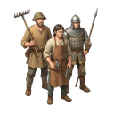

[📖 Indice della wiki](README.md) › ⚔️ La guerra &nbsp;·&nbsp; [🇬🇧 English](../EN/PVP-challenging-players.md)

# PVP: sfidare i giocatori

*Sfidare altri giocatori del Regno: chi si può attaccare, come si svolge lo scontro, bottino e limiti.*

---

## Sfidare un altro sovrano

Il **PVP** è lo scontro tra giocatori: scegli un avversario, mandi il tuo esercito e, se riesci ad attraversare le sue difese, torni a casa con il bottino. È la parte più rischiosa del gioco, ma anche l'unica in cui il nemico ragiona quanto te: ha costruito le sue difese, assegnato le guarnigioni, schierato le trappole. Chi vince bene è chi ha preparato di più.

Nella scheda **PVP/PVE** premi **PVP**. Finché non raggiungi il livello richiesto il pannello è bloccato e te lo dice (il livello esatto lo leggi lì). Le truppe da inviare, come sempre, si scelgono una sola volta nel pannello **Esercito da Inviare**.

## Chi puoi attaccare

Non si sceglie da un elenco infinito: il gioco ti propone una lista di avversari adatti a te.

- **Solo del tuo Regno.** Gli altri Regni sono irraggiungibili: ne parla la pagina [Regni](Regni.md).
- **Con una forza simile alla tua.** La lista privilegia avversari di potenza paragonabile; se ce ne sono pochi, il gioco allarga gradualmente il confronto, in modo da offrirti sempre qualcuno.
- **Mai i tuoi altri villaggi.** Se hai più villaggi sullo stesso Account, tra loro non ci si attacca.
- **Non chi è protetto.** Chi ha attivo lo **Scudo della Pace** non compare nella lista, e chi non ha ancora raggiunto il livello di sblocco del PVP nemmeno.

> [!WARNING]
> **Lo scudo vale in entrambe le direzioni**
>
> Se hai tu lo **Scudo della Pace** attivo, non puoi attaccare altri giocatori: il gioco ti avvisa e non parte nulla. Contro i Barbari, invece, puoi continuare a combattere. Se vuoi attaccare, aspetta la fine dello scudo.

## La lista degli avversari

Ogni avversario è una scheda con il  **Livello**, il nome e un indicatore di **potenza** colorato rispetto alla tua: ti dice a colpo d'occhio se è più debole, simile o più forte di te. Sono indicazioni di massima: la potenza somma strutture, esercito e ricerche, ma non dice come sono schierate le difese. Per questo esiste lo spionaggio.

Su ogni scheda vedi anche quanti **Diamanti Viola e Blu** puoi ancora saccheggiare a quell'avversario. Il numero è il minore tra quello che il limite ti concede e quello che il limite protegge a lui: non rivela i diamanti che possiede.

In alto trovi il riquadro **Limiti settimanali diamanti**, con due righe: **Saccheggio** (quanti diamanti hai preso questa settimana con attacchi e Raduni PVP) e **Persi** (quanti ne hai persi tu come difensore). Accanto c'è il conto alla rovescia del rinnovo, che avviene ogni lunedì.

## Come si attacca

1. Scegli le truppe in **Esercito da Inviare**.
2. Tocca la scheda dell'avversario che ti interessa.
3. Se vuoi, premi **Esplora**: le tue spie costano  **Oro** e ti portano un Report con ciò che sono riuscite a scoprire (vedi [Spionaggio](Spionaggio.md)).
4. Premi **Attacca**. Lo scontro si risolve subito e il risultato arriva nei **Report**.

## Dentro la battaglia

L'attacco segue l'ordine delle difese del tuo avversario, dall'esterno verso l'interno. Ognuno dei sei strati (**Ingresso, Mura, Cancello, Torri, Centro, Castello**) è uno scontro a sé, e in coda c'è il **Villaggio**, dove combattono i soldati rimasti a casa. In ogni scontro:

1. Se la struttura ha delle **Trappole**, entrano in azione contro gli assalitori e li indeboliscono.
2. Parlano le **unità a distanza** delle due parti. Gli  **Arcieri** e le  **Catapulte** consumano  **Frecce**, e senza munizioni si combatte molto al di sotto del proprio valore.
3. Poi la **mischia**: qui la **Salute** e la **Difesa** della struttura fanno da cuscinetto, assorbendo colpi insieme ai soldati che la presidiano.
4. Chi ha ancora truppe in piedi passa allo strato successivo; gli assalitori caduti non tornano.

Il successo si decide nell'ultimo scontro, quello del **Villaggio**: se alla fine i difensori rimasti a casa sono stati eliminati, l'attacco è riuscito e puoi saccheggiare. Ma per arrivarci con un esercito ancora in piedi bisogna aver logorato bene tutti gli strati precedenti: un esercito che si spegne per strada torna a casa senza bottino.

## Il bottino

Se vinci, i tuoi sopravvissuti saccheggiano **una parte** delle risorse civili dell'avversario, e mai tutte: **Cibo, Legno, Pietra, Ferro e Oro**. Quanto riesci a portare via dipende dallo **Zaino** delle truppe rimaste in piedi, per questo non conta solo vincere ma anche come vinci. La  **Popolazione**, le risorse militari e le scorte di Tributi non si toccano.

I **Diamanti** seguono regole più severe: li prendi solo se né il tuo limite settimanale né quello del tuo avversario sono esauriti. Il limite protegge i difensori da una raffica di attacchi consecutivi e ti dà un tetto realistico a ciò che puoi guadagnare. Quando i diamanti sono esauriti, il saccheggio continua con le altre risorse.

## Esperienza, statistiche e quest

Entrambi i giocatori guadagnano  **Esperienza** per le unità nemiche eliminate, e l'attaccante ne riceve anche per le trappole che sono scattate. Le battaglie contano nelle statistiche e possono far avanzare le Quest. Di Esperienza e Livello parla la pagina dedicata più avanti.

## Quando sei tu a essere attaccato

Non c'è nulla da fare nel momento in cui accade: lo scontro si risolve in un istante, anche mentre sei offline. Ti arriva una copia del Report: strato per strato, trappole scattate, perdite e risorse perse. Cosa puoi fare prima e dopo:

- **Prima:** assegna le guarnigioni, schiera le trappole, tieni riparate le difese ([La Città e la difesa](La-Citta-e-la-difesa.md)), non lasciare i magazzini pieni, o attiva lo **Scudo della Pace** se vuoi una pausa dalle guerre (non farlo all'ultimo: con un [Raduno](Raduni.md) aperto contro di te non si può più acquistare né attivare).
- **Dopo:** leggi il Report, ripara le strutture danneggiate e ricostruisci le trappole usate. Le truppe perse vanno riaddestrate.

Se qualcuno ha provato a spiarti prima di attaccare, potresti aver trovato un avviso di *Spionaggio rilevato*: non è garanzia di un attacco in arrivo, ma è un buon motivo per controllare le difese.

## Consigli

> [!TIP]
> **Ragionare da stratega**
>
> **Non fidarti solo del colore.** Un avversario «simile» con guarnigioni ben distribuite e trappole schierate può essere più duro di uno «più forte» lasciato scoperto: Esplora ti fa vedere la differenza. **Porta le Frecce.** Gli Arcieri senza munizioni sono una zavorra. **Valuta il rischio.** I soldati caduti non tornano, e una sconfitta ti costa truppe senza darti nulla in cambio.

## Domande frequenti

<b>Perché la lista degli avversari è vuota?</b>

Può darsi che il tuo Regno sia poco popolato, che gli altri giocatori abbiano lo Scudo della Pace attivo o non abbiano ancora sbloccato il PVP. La lista si aggiorna da sola nel tempo.

<b>Posso attaccare qualcuno di un altro Regno?</b>

No. Solo i giocatori del tuo Regno sono raggiungibili, e per cambiare Regno trovi le condizioni nella pagina Regni.

<b>Cosa succede se perdo?</b>

Perdi le truppe cadute e non porti a casa nessun bottino. I sopravvissuti tornano al villaggio e il Report ti mostra in quale strato l'attacco si è fermato.

<b>L'avversario viene avvisato che voglio attaccarlo?</b>

No: l'attacco si risolve all'istante e lui lo scopre dal Report. Lo Spionaggio, invece, può essere scoperto, come spiega la pagina dedicata.

---

⬅️ [Precedente: PVE: Barbari](PVE-Barbari.md) &nbsp;·&nbsp; [📖 Indice della wiki](README.md) &nbsp;·&nbsp; [Successiva: Spionaggio](Spionaggio.md) ➡️
