[📖 Indice della wiki](README.md) › 📈 Crescita &nbsp;·&nbsp; [🇬🇧 English](../EN/Monthly-Quests.md)

# Quest Mensili

*Gli obiettivi del mese, la barra dei punti e le ricompense da riscuotere.*

---

## Una lista di cose da fare, e un premio ogni volta

Le **Quest Mensili** sono obiettivi che il gioco ti propone mentre giochi: costruire, addestrare, spendere risorse, affrontare i Barbari e altro ancora. Ogni volta che ne completi una, guadagni dei *punti* che riempiono una barra; quando la barra raggiunge certe tappe si sbloccano ricompense in **Diamanti**. Non c'è nulla da cercare: le Quest seguono quello che fai già, e ti danno qualcosa in più per farlo.

Le trovi nella scheda **Quest Mensili**, l'ultima della barra in basso. La schermata è divisa in due pannelli: **Ricompense Mensili**, con la barra dei punti, e **Quest**, con l'elenco degli obiettivi.

> [!NOTE]
> **Punti Quest e Livello sono due cose diverse**
>
> Accanto a ogni Quest leggi «+ Exp»: sono punti della barra delle Quest, non fanno salire il tuo  **Livello**. Quell' **Esperienza** nasce solo dalle battaglie, come spiega [Esperienza e livelli](Esperienza-e-livelli.md). Il conto dei punti Quest è separato e riparte ogni mese.

## Come funziona una Quest

Ogni riga dell'elenco è un obiettivo con una descrizione («Costruisci fattorie», «Addestra guerrieri», «Utilizza legno»…), una barra di avanzamento e tre indicazioni utili:

- Il **progresso**, nella forma «quanto hai fatto / quanto serve». Si aggiorna da solo mentre giochi, anche se non hai la schermata aperta.
- Il conteggio **Completata** (per esempio «2/4»): quasi tutte le Quest si possono completare più volte nel mese, fino a un massimo che vedi sulla riga.
- I punti in palio, a destra. Sono i punti che ricevi al prossimo completamento.

Completare una Quest più volte è sempre un po' più impegnativo: l'obiettivo si alza a ogni giro, ma in cambio anche i punti in palio crescono. Quando una Quest ha raggiunto il suo massimo di completamenti sparisce dall'elenco: meno righe, meno rumore. Se superi l'obiettivo di molto, di norma l'eccedenza non va persa e viene riportata sul giro successivo.

L'elenco mostra dieci Quest per volta: usa **Precedenti** e **Successive** sotto la lista per scorrere le pagine.

## Cosa chiedono le Quest

- **Costruire** — Quasi ogni struttura ha la sua Quest, e ci sono anche quelle «generiche» che contano qualunque struttura civile o militare: 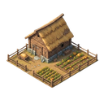 **Fattoria**, 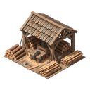 **Segheria**, 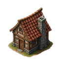 **Abitazioni**, 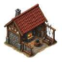 **Officina spade**, 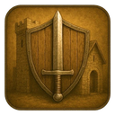 **Caserma guerrieri** e così via. Vedi [Costruzione](Costruzione-ed-edifici.md).
- **Addestrare** — Addestra 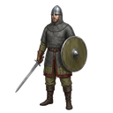 **Guerrieri**, **Lanceri**, 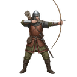 **Arcieri** o 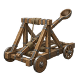 **Catapulte**, oppure qualsiasi unità. Vedi [Esercito](Esercito.md).
- **Combattere** — Eliminare truppe nemiche, affrontare i Barbari (Villaggi e Città) e attaccare altri giocatori. Vedi [PVE: Barbari](PVE-Barbari.md) e [PVP: sfidare i giocatori](PVP-sfidare-i-giocatori.md).
- **Esplorare** — Mandare le spie: ci sono Quest per i Villaggi Barbari, per le Città Barbare, per i giocatori e per qualsiasi esplorazione. Vedi [Spionaggio](Spionaggio.md).
- **Utilizzare** — Spendere le risorse: quelle civili, l'equipaggiamento militare e persino i 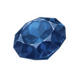 **Diamanti Blu** e Viola. Conta quello che spendi davvero in costruzioni, addestramenti, ricerche e simili.
- **Velocizzare** — Accorciare i tempi con i Diamanti: una Quest per le costruzioni, una per gli addestramenti e una per qualsiasi cosa.
- **Acquistare un Feudo** — La Quest legata ai **Feudi** si ripete più volte nel mese e chiede un po' di più a ogni giro. Sul sito vedi [Feudi e rendita](Feudi-e-rendita.md).

## Le Quest che non si ripetono

Alcune Quest si completano una volta sola e basta: quelle che premiano il raggiungimento di un certo  **Livello**, e la Quest che chiede di portare a termine tutte le altre. A differenza del resto, queste *non* ripartono dal nulla il mese successivo: un traguardo raggiunto resta raggiunto.

## La barra delle Ricompense

Il pannello **Ricompense Mensili** mostra una sola barra, che si riempie con i tuoi punti. Lungo la barra ci sono venti tappe, con il punteggio richiesto scritto sopra ciascuna. Le tappe non sono equidistanti nel punteggio, ma sono disegnate a distanza regolare per restare leggibili: sul telefono la striscia scorre di lato. Su ogni tappa vedi l'icona del premio con il suo valore.

Ogni tappa ha due ricompense:

| Normale | 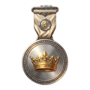 GamePass Silver |
| --- | --- |
| Sopra la barra, per tutti i giocatori. Sono premi in 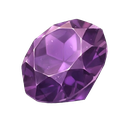 **Diamanti Viola**; alcune tappe regalano invece  **Diamanti Blu**, e le riconosci dall'icona. | Sotto la barra, solo con il  **GamePass Silver** attivo. Un secondo premio per ogni tappa e, all'ultima, un **Feudo Leggendario**. Senza il pass le vedi comunque, ma restano bloccate. Vedi [GamePass e premi giornalieri](GamePass-e-premi-giornalieri.md). |

Quando i punti raggiungono una tappa, la ricompensa diventa «pronta» e si illumina: **toccala per riscuoterla**. Una volta presa resta segnata come riscossa. Se attivi il GamePass Silver a metà mese, le ricompense Silver delle tappe già superate diventano subito riscuotibili.

> [!WARNING]
> **Riscuoti prima del rinnovo**
>
> Le ricompense non si prendono da sole: tocca a te riscuoterle. Il primo giorno del mese tutto ricomincia, punti, Quest e ricompense, e quello che non hai ritirato va perso. Prima della fine del mese dai sempre un'occhiata alla barra.

## Il rinnovo mensile

Il primo giorno di ogni mese, insieme al rinnovo del mondo barbaro (vedi [Città e Villaggi Barbari](Citta-e-Villaggi-Barbari.md)), le Quest ricominciano: progressi e completamenti tornano a zero, i punti si azzerano e le ricompense tornano da riscuotere. Fanno eccezione le Quest che non si ripetono, di cui sopra.

## Consigli

> [!TIP]
> **Giocare con la lista in mano**
>
> **Guarda l'elenco prima di una sessione.** Molte Quest si completano da sole con quello che stai per fare: se devi costruire o addestrare comunque, controlla cosa conta. **Preferisci le Quest generiche.** Quelle che contano «qualsiasi» struttura o unità avanzano a ogni azione. **Non aspettare l'ultimo giorno.** Il rinnovo scatta il primo del mese, e le ricompense non riscosse non si recuperano.

## Domande frequenti

<b>I punti Quest mi fanno salire di Livello?</b>

No. Sono un conto separato, che serve solo a riempire la barra delle Ricompense Mensili. Il  **Livello** sale con l'Esperienza delle battaglie.

<b>Una Quest non avanza, cosa controllo?</b>

Leggi bene la descrizione: conta solo ciò che rientra proprio in quell'azione. Se ti sembra davvero che qualcosa non funzioni, scrivi al supporto indicando la Quest.

<b>Posso riscuotere una ricompensa a distanza di giorni?</b>

Sì, finché non scatta il rinnovo mensile. Una tappa raggiunta resta pronta fino a quando non la tocchi.

<b>Perché le ricompense GamePass Silver sono bloccate?</b>

Perché il pass non è attivo: le vedi comunque, ma restano bloccate. Se lo attivi, le tappe già raggiunte si sbloccano subito.

<b>Cosa succede alle Quest completate al massimo?</b>

Spariscono dall'elenco fino al rinnovo del mese, tranne quelle che non si ripetono, che restano completate.

---

⬅️ [Precedente: Esperienza e livelli](Esperienza-e-livelli.md) &nbsp;·&nbsp; [📖 Indice della wiki](README.md) &nbsp;·&nbsp; [Successiva: GamePass e premi giornalieri](GamePass-e-premi-giornalieri.md) ➡️
