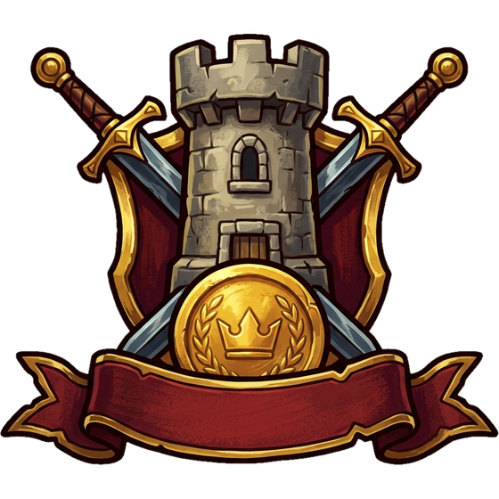

# Wiki di Warriors & Wealth

[🇬🇧 English](../EN/README.md) &nbsp;·&nbsp; [🏠 Home](../../README.md) &nbsp;·&nbsp; [▶️ Gioca ora](https://milos.warriorsandwealth.com:8448/index.html)

Benvenuto nella guida ufficiale di **Warriors & Wealth**, lo strategico medievale online: qui trovi ogni parte del gioco spiegata passo dopo passo, con gli stessi nomi di schede e pulsanti che vedi nel client. La stessa wiki è disponibile anche dentro il gioco, dal menu del giocatore.

## 🧭 Primi passi

| Pagina | Di cosa parla |
| --- | --- |
| [Benvenuto in Warriors & Wealth](Introduzione.md) | Che gioco è, come funziona una partita e dove trovare ogni cosa. |
| [Guida rapida](Guida-rapida.md) | Da dove cominciare: come orientarsi, cosa fare nelle prime ore, la routine di ogni giorno e gli errori più comuni. |

## 🏘️ Il villaggio

| Pagina | Di cosa parla |
| --- | --- |
| [Risorse](Risorse.md) | Cosa produce il villaggio, cosa consuma e come tenere in equilibrio scorte, mantenimento e magazzini. |
| [Costruzione ed edifici](Costruzione-ed-edifici.md) | Le strutture del villaggio, come si costruiscono, quanto costano davvero e come funzionano le code. |
| [Esercito](Esercito.md) | Le quattro classi di truppe, come si addestrano, quanto costano da mantenere e come funzionano le trappole. |
| [Ricerca e Tecnologia](Ricerca-e-Tecnologia.md) | Come rendere più forti villaggio ed esercito: ricerche a livelli e albero della tecnologia. |
| [Inventario e oggetti](Inventario-e-oggetti.md) | Gli oggetti consumabili: dove si comprano, le sei categorie, le regole dei bonus a tempo e gli oggetti speciali. |

## 🗺️ Il mondo

| Pagina | Di cosa parla |
| --- | --- |
| [Regni](Regni.md) | Il mondo è diviso in piccole comunità: scopri cosa condividi con i tuoi vicini e come cambiare casa. |
| [Città e Villaggi Barbari](Citta-e-Villaggi-Barbari.md) | Come sono fatti i Barbari: Villaggi personali e Città del Regno, la scala dei venti livelli, il bottino e il rinnovo mensile. |
| [Raduni](Raduni.md) | Unire le truppe del Regno in un unico assalto: come si crea, come ci si unisce, cosa succede a chi è nel mirino e come si divide il bottino. |

## ⚔️ La guerra

| Pagina | Di cosa parla |
| --- | --- |
| [La Città e la difesa](La-Citta-e-la-difesa.md) | Le sei difese del villaggio: guarnigioni, trappole, riparazioni e come prepararsi a essere attaccati. |
| [PVE: Barbari](PVE-Barbari.md) | Villaggi e Città Barbare: come si attacca, cosa si guadagna e come si sale lungo la scala dei livelli. |
| [PVP: sfidare i giocatori](PVP-sfidare-i-giocatori.md) | Sfidare altri giocatori del Regno: chi si può attaccare, come si svolge lo scontro, bottino e limiti. |
| [Spionaggio](Spionaggio.md) | Esplora: cosa costa, cosa rivela e come difendersi dallo spionaggio altrui. |
| [Report di battaglia](Report-di-battaglia.md) | Come leggere i Report: l'elenco, i preferiti e il dettaglio di uno scontro, fase per fase. |

## 📈 Crescita

| Pagina | Di cosa parla |
| --- | --- |
| [Esperienza e livelli](Esperienza-e-livelli.md) | Come si guadagna Esperienza, come si sale di Livello e a cosa serve. |
| [Quest Mensili](Quest-Mensili.md) | Gli obiettivi del mese, la barra dei punti e le ricompense da riscuotere. |
| [GamePass e premi giornalieri](GamePass-e-premi-giornalieri.md) | Silver e Gold: cosa sbloccano, come si riscuotono i premi e perché la serie non va interrotta. |

## 💎 Economia

| Pagina | Di cosa parla |
| --- | --- |
| [Negozio e Diamanti](Negozio-e-Diamanti.md) | Pacchetti, oggetti, valute e pagamenti: cosa si compra e come. |
| [Feudi e rendita](Feudi-e-rendita.md) | Come si acquistano i Feudi, come funzionano i Tributi e come si scambiano o si prelevano. |

## ❓ Aiuto

| Pagina | Di cosa parla |
| --- | --- |
| [Glossario](Glossario.md) | Le parole del gioco spiegate in poche righe, con il rimando alla pagina che le approfondisce. |
| [Domande frequenti](Domande-frequenti.md) | Le risposte brevi alle domande più comuni su villaggio, battaglie, Diamanti e account. |
