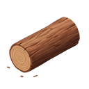
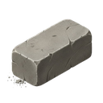
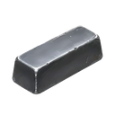
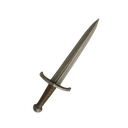
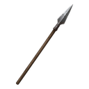
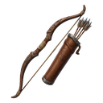
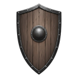
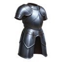

[📖 Indice della wiki](README.md) › 🏘️ Il villaggio &nbsp;·&nbsp; [🇬🇧 English](../EN/Resources.md)

# Risorse

*Cosa produce il villaggio, cosa consuma e come tenere in equilibrio scorte, mantenimento e magazzini.*

---

## Il cuore del villaggio

Ogni cosa che fai in Warriors & Wealth ha un prezzo: costruire, addestrare, ricercare, perfino tenere in piedi l'esercito. Le risorse sono il carburante di tutto, e capire da dove arrivano, dove si fermano e dove spariscono è la differenza tra un villaggio che cresce con calma e uno che si inceppa proprio quando serve di più.

Le trovi tutte nella **barra in alto**, sempre visibile. Nella riga superiore ci sono il tuo nome, il  **Livello**, l' **Esperienza** e i **Diamanti**; nella riga sotto le risorse del villaggio, con un pulsante per passare dal gruppo *civile* a quello *militare*, e i  **Tributi**. Toccando una qualsiasi risorsa si apre la sua scheda, con la spiegazione e i numeri aggiornati in tempo reale.

## Le risorse civili

Sono il motore economico: arrivano dalle strutture civili, si accumulano da sole nel tempo e sostengono quasi ogni attività.

| Risorsa | Da dove arriva | A cosa serve |
| --- | --- | --- |
|  **Cibo** | Fattoria | Prezzo di molte costruzioni e addestramenti, e soprattutto il mantenimento delle truppe. |
|  **Legno** | Segheria | Il materiale di base di quasi tutto, indispensabile fin dai primi passi. |
|  **Pietra** | Cava di pietra | Strutture e fortificazioni: la voce che pesa quando si costruisce in grande. |
|  **Ferro** | Miniera di ferro | Armi, armature e unità più avanzate: diventa più importante via via che si cresce. |
|  **Oro** | Miniera d'oro | Mantenimento di truppe e strutture. Spesso è il vero collo di bottiglia. |
|  **Popolazione** | Abitazioni | Chi lavora, costruisce, combatte: ogni edificio, ogni soldato e ogni ricerca ne richiede un po'. |

Cibo, legno, pietra, ferro e oro si possono anche **saccheggiare**: le Città Barbare e gli altri giocatori ne custodiscono, e chi vince una battaglia porta a casa il bottino (e chi perde una difesa lo lascia sul campo). La Popolazione, invece, non si ruba né si guadagna in battaglia: cresce soltanto con le Abitazioni.

## Come leggere la scheda di una risorsa

Tocca il Cibo nella barra e guarda cosa compare. Le righe che contano sono quattro:

- **Produzione.** Due numeri affiancati, sempre *al secondo*: quello arancione è la produzione **netta** (quello che ti entra davvero), quello verde la produzione **lorda** (quanto producono le strutture prima di togliere i consumi).
- **Edifici.** Quanto le tue strutture si «mangiano» ogni secondo per restare in funzione.
- **Esercito.** Quanto costano le truppe, per tutte le unità che possiedi, anche quelle schierate in difesa. Compare solo per  **Cibo** e  **Oro**, che sono le due risorse con cui si «pagano» i soldati.
- **Limite.** Fin dove può arrivare quella scorta.

> [!TIP]
> **Il primo numero da guardare**
>
> Prima di costruire una nuova caserma o di addestrare un gruppo di truppe, apri la scheda del Cibo e dell'Oro e guarda la produzione **netta**. Se è già bassa, ogni nuovo soldato la farà scendere ancora.

## Il magazzino e il limite

Ogni risorsa ha un **limite** massimo di scorta, e più strutture produttive possiedi, più il limite sale: ogni Fattoria in più allarga il magazzino del Cibo, ogni Segheria quello del Legno, e così via. Quando una scorta tocca il suo limite, la produzione di quella risorsa si ferma finché non spendi qualcosa.

Da qui nasce un'abitudine utile: non lasciare i magazzini pieni per giorni. Una risorsa ferma al limite è produzione sprecata, e una scorta enorme è anche un bottino invitante per chi decide di attaccarti.

> [!NOTE]
> **Anche quando non ci sei**
>
> Produzione e consumi continuano a scorrere **anche se sei offline**. Quando rientri trovi quello che si è accumulato, ma anche quello che le truppe e gli edifici hanno consumato nel frattempo.

## Il mantenimento: il costo nascosto della crescita

Costruire una struttura o addestrare un'unità non è un pagamento una tantum: **le unità, le Caserme e le strutture militari hanno un mantenimento** che viene scalato di continuo. Cibo e Oro servono soprattutto alle truppe; le Caserme e le Officine consumano a loro volta risorse per restare operative.

Finché la produzione netta è positiva non te ne accorgi. Se invece diventa negativa, le scorte calano fino a zero (non scendono mai sotto) e a quel punto non puoi più costruire, addestrare o ricercare, proprio quando ti servirebbe una Fattoria in più per rimediare.

> [!WARNING]
> **Da non sottovalutare**
>
> Un esercito enorme che il villaggio non riesce a mantenere rallenta la crescita invece di accelerarla. Cresci con equilibrio: ogni volta che aggiungi truppe o strutture militari, controlla che la produzione netta di Cibo e Oro regga ancora. Se ti trovi in affanno, le Città Barbare e i Villaggi Barbari sono un modo per rimettere in moto le scorte.

## Le risorse militari

Un esercito non si equipaggia con l'oro: le armi si **producono**, nelle Officine. Il gruppo militare è nascosto dietro il pulsante di cambio nella barra, accanto alle risorse civili.

| Risorsa | Struttura che la produce | Ruolo |
| --- | --- | --- |
|  **Spade** | Officina Spade | Equipaggiamento base di molte unità. |
|  **Lance** | Officina Lance | L'arma dei Lancieri. |
|  **Archi** | Officina Archi | Servono per addestrare gli Arcieri. |
|  **Scudi** | Officina Scudi | Rafforzano la tenuta di molte unità. |
|  **Armature** | Officina Armature | Equipaggiamento difensivo delle truppe. |
|  **Frecce** | Officina Frecce | Munizioni delle unità a distanza. |

La differenza più importante con le risorse civili è come si *usano*. Spade, Lance, Archi, Scudi e Armature si spendono quando **addestri** le unità che le richiedono. Le **Frecce** sono diverse: sono munizioni, e quelle che servono si consumano **durante le battaglie**. Se non ne hai abbastanza, le unità a distanza combattono molto al di sotto del loro valore. Per questo un'Officina Frecce non è un optional per chi punta su Arcieri e Catapulte.

Anche per le risorse militari c'è un **limite di magazzino**, che cresce con il numero di Officine del tipo corrispondente, e nella scheda di ciascuna trovi la produzione al secondo. I dettagli su cosa serve a ogni unità sono nella pagina [Esercito](Esercito.md).

## Le risorse rare

Sono la «valuta pregiata» del gioco. Non escono dagli edifici: si conquistano.

- **Diamanti Blu.** Sono i più comuni e i più versatili. Servono a **velocizzare** costruzioni, addestramenti e trappole (il pulsante *Velocizza* ti dice quanto tempo toglie ogni diamante) e a comprare nel Negozio. Si ottengono giocando: battaglie, Quest, GamePass.
- **Diamanti Viola.** I più rari e preziosi. Servono per le cose importanti, come il Cambio Regno, e le Città Barbare sono una delle poche fonti per guadagnarli giocando, con limiti pensati per distribuirli con equità (ne parla la pagina [Regni](Regni.md)). Esiste anche uno scambio tra Viola e Blu: il tasso lo leggi nella schermata di scambio.
- **Tributi.** Non vengono dalle battaglie: li producono i **Feudi**, nel tempo, in base alla loro rarità. Sono il «reddito» del tuo villaggio e, a differenza dei Diamanti, non si possono saccheggiare. Nota importante: la generazione dei Tributi è un servizio che Warriors & Wealth si impegna a mantenere attivo finché possibile, ma non è garantita per sempre: ci riserviamo il diritto di modificarla o di toglierla, anche se l'intenzione è di tenerla sempre accesa. Nella scheda **Feudi** della Panoramica trovi anche il loro scambio in Diamanti Viola.

> [!WARNING]
> **Occhio durante le guerre**
>
> Le scorte di **Diamanti** si possono perdere se subisci un attacco andato male in difesa, entro i limiti previsti dalle regole del PVP. Non lasciare grandi quantità ferme se sai di essere un bersaglio: spendile bene, o proteggi il villaggio.

## Domande frequenti

<b>Perché non produco più nulla?</b>

Quasi sempre una risorsa è arrivata al suo **limite**: spendila e la produzione riparte. Apri la scheda della risorsa dalla barra in alto per vederlo.

<b>Le mie scorte calano anche se non spendo niente: è normale?</b>

Sì, se la produzione **netta** è negativa: truppe e strutture consumano più di quanto produci. Costruisci più strutture produttive o riduci i consumi prima che le scorte arrivino a zero.

<b>La Popolazione si può saccheggiare?</b>

No: cresce soltanto con le Abitazioni e si spende costruendo, addestrando e ricercando.

<b>Cosa succede ai miei magazzini quando sono offline?</b>

Continuano a riempirsi (fino al limite) e a consumarsi come sempre. Il villaggio resta attaccabile, quindi un magazzino pieno pesa quanto un esercito debole.

<b>Dove vedo quanto mi costa una struttura o un'unità?</b>

Nelle schermate [Costruzione](Costruzione-ed-edifici.md) e Addestramento, premendo il pulsante **i** della riga: compaiono costo, tempo ed effetto, già moltiplicati per la quantità che hai scelto.

---

⬅️ [Precedente: Guida rapida](Guida-rapida.md) &nbsp;·&nbsp; [📖 Indice della wiki](README.md) &nbsp;·&nbsp; [Successiva: Costruzione ed edifici](Costruzione-ed-edifici.md) ➡️
